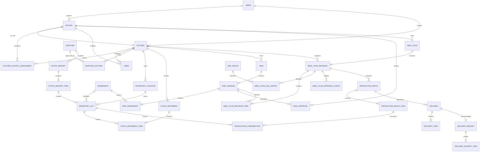

# CanTinSo — ERD nghiệp vụ chuỗi cung ứng bữa ăn

> Trạng thái: thiết kế mục tiêu, chưa triển khai schema/migration  
> Nhánh tham chiếu: feature/ubnd-ward-school-access  
> Prisma schema tham chiếu: cantinso-backend/prisma/schema.prisma tại commit 7285c6a

## 1. Quy tắc nghiệp vụ đã chốt

1. **Công thức thuộc bếp tạo món.** Một bếp trung tâm có thể dùng cùng món/công thức cho nhiều trường đang được phân công; bếp tại trường chỉ sở hữu công thức của chính bếp đó.
2. **Thực đơn thuộc từng trường.** Mỗi trường có lịch thực đơn, số suất, trạng thái gửi duyệt và lịch sử duyệt độc lập; mỗi thực đơn chỉ rõ bếp chịu trách nhiệm chuẩn bị.
3. **Duyệt món theo trường (school).** Món/công thức dùng chung không đồng nghĩa tự động được mọi trường chấp nhận. Mỗi trường duyệt phiên bản món mà trường đó cho phép sử dụng. Việc này tách biệt với duyệt thực đơn.
4. **Công thức dùng chung giữa nhóm tuổi (same).** Một phiên bản công thức chuẩn dùng chung; định lượng khẩu phần và số suất có thể điều chỉnh theo nhóm tuổi ở dòng thực đơn/kế hoạch phục vụ. Không nhân bản công thức chỉ vì khác nhóm tuổi.
5. **Kho bếp trung tâm quản lý tập trung (central).** Mỗi bếp là một đơn vị tồn kho độc lập; kho trung tâm không chia tồn vật lý thành các kho con theo trường. Khi xuất dùng/giao hàng phải ghi rõ trường/đợt sản xuất nhận phần nguyên liệu hoặc suất ăn. Bếp tại trường, nếu có, có kho riêng.
6. Công thức tham chiếu danh mục nguyên liệu chuẩn, **không tham chiếu lô tồn kho**. Lô chỉ được chọn khi nhập/xuất/sản xuất thực tế.
7. Dữ liệu lịch sử không bị ghi đè: phiên bản công thức, bản thực đơn đã gửi/duyệt, phiếu kho và lô đã dùng phải truy xuất được.
8. Mọi phạm vi dữ liệu và quyền được kiểm tra ở backend; frontend không phải ranh giới bảo mật.

## 2. ERD mục tiêu — quan hệ chính

- Ward 1—N School; Ward 1—N Kitchen trung tâm.
- School 1—0..1 Kitchen tại trường.
- Kitchen N—N School thông qua KitchenSchoolAssignment có startsAt/endsAt/isActive.
- Kitchen 1—N User, Dish, InventoryLocation, StockReceipt, StockMovement, MealPlan (vai trò bếp chuẩn bị).
- Supplier N—N Kitchen qua SupplierKitchen.
- Ingredient 1—N IngredientNutrition; Ingredient N—N Allergen qua IngredientAllergen.
- Kitchen 1—N InventoryLocation; InventoryLocation 1—N InventoryLot.
- StockReceipt 1—N StockReceiptItem; StockReceiptItem có thể tạo một InventoryLot.
- InventoryLot 1—N StockMovementItem; StockMovement 1—N StockMovementItem.
- Kitchen 1—N Dish; Dish 1—N DishVersion; DishVersion 1—N DishIngredient.
- DishIngredient N—1 Ingredient; DishVersion 1—N DishApproval; School 1—N DishApproval.
- School 1—N MealPlan; Kitchen 1—N MealPlan; MealPlan 1—N MealPlanItem. Mỗi MealPlan do đúng một bếp lập đề xuất cho đúng một trường.
- MealPlanItem N—1 DishVersion và N—1 AgeGroup; MealPlan 1—N MealPlanApproval và 1—N MealPlanRevision.
- MealPlan/revision 1—N ProductionBatch; ProductionBatch liên kết các giao dịch xuất kho và Delivery.
- InventoryLot 1—N TraceEvent; TraceEvent có thể tham chiếu StockMovement, ProductionBatch hoặc Delivery.

## 3. Nhóm model mục tiêu và trách nhiệm

### 3.1 Tổ chức, phân công và người dùng

Giữ Ward, School, Kitchen, KitchenSchoolAssignment, User.

- Kitchen.type=CENTRAL: bắt buộc có wardId, không có schoolId.
- Kitchen.type=SCHOOL: bắt buộc có schoolId, không có wardId.
- Một trường chỉ có một đơn vị bếp phục vụ đang hiệu lực tại một thời điểm (bếp trung tâm được phân công hoặc bếp tại trường). Quy tắc exclusivity đang được DB trigger bảo vệ.
- Phân công cần giữ lịch sử bằng startsAt, endsAt, isActive; không xóa bản ghi cũ khi đổi bếp.
- Người dùng bếp gắn kitchenId; BGH gắn schoolId; UBND gắn wardId.

### 3.2 Danh mục nguyên liệu, đơn vị, dinh dưỡng

- Ingredient: danh mục chuẩn dùng chung toàn hệ thống; mã nguyên liệu ổn định, tên, nhóm, đơn vị cơ sở, trạng thái.
- Unit và IngredientUnitConversion: chuẩn hóa đơn vị (g, kg, ml, l, cái...) và quy đổi có kiểm soát. Không dùng chuỗi đơn vị tự do ở từng giao dịch.
- IngredientNutrition: giá trị dinh dưỡng theo 100g/100ml hoặc đơn vị tham chiếu xác định; lưu nguồn dữ liệu, ngày hiệu lực và phiên bản. Không coi giá trị ước tính là kết quả kiểm nghiệm.
- Allergen và IngredientAllergen: quan hệ nhiều-nhiều; công thức kế thừa cảnh báo dị ứng từ nguyên liệu.

### 3.3 Nhà cung cấp và kho

- Supplier: hồ sơ nhà cung cấp độc lập, không thuộc riêng một trường.
- SupplierKitchen: phạm vi bếp được phép mua từ nhà cung cấp; có trạng thái và thời gian hiệu lực. Việc được liên kết không thay thế kiểm tra hồ sơ/hợp đồng.
- InventoryLocation: vị trí/kho thuộc đúng một Kitchen. Tối thiểu mỗi bếp có một kho chính.
- StockReceipt / StockReceiptItem: chứng từ nhập, nhà cung cấp, bếp nhận, ngày nhận, chứng từ, người xác nhận, mặt hàng, số lượng, đơn vị, giá và thông tin lô/hạn dùng.
- InventoryLot: lô thực tế của một nguyên liệu tại một bếp/vị trí; gồm mã lô, nhà sản xuất, ngày sản xuất/hạn dùng, số lượng nhập và trạng thái kiểm tra. Ràng buộc duy nhất mã lô theo bếp (hoặc theo bếp + nguyên liệu nếu nghiệp vụ cho phép trùng mã nhà sản xuất).
- StockMovement / StockMovementItem: sổ cái nhập/xuất/điều chỉnh/chuyển vị trí/hoàn trả. Giao dịch đã ghi sổ không được sửa/xóa; sai sót được đảo bằng giao dịch đối ứng.
- Số tồn hiện tại có thể lưu cache trên lô để đọc nhanh, nhưng phải đối chiếu được từ ledger. Không được cập nhật tồn tùy tiện ngoài giao dịch kho.
- Với bếp trung tâm, tồn kho thuộc bếp trung tâm. Việc phân bổ nhu cầu cho Trường A/B/C là dữ liệu kế hoạch hoặc xuất dùng theo đợt/trường, không tạo ba bản tồn độc lập giả tạo.

### 3.4 Món, phiên bản công thức và duyệt món theo trường

- Dish: danh tính món thuộc một Kitchen (kitchenId), mã duy nhất trong phạm vi bếp, tên, nhóm bữa, trạng thái.
- DishVersion: phiên bản bất biến của công thức: số phiên bản, khẩu phần chuẩn, hướng dẫn chế biến, hiệu lực, người tạo. Chỉnh sửa công thức đã phát hành phải tạo phiên bản mới.
- DishIngredient: thành phần của một phiên bản, tham chiếu Ingredient, số lượng và đơn vị chuẩn, hao hụt/sơ chế nếu cần. Không chứa inventoryLotId.
- DishNutrition: snapshot kết quả tính dinh dưỡng của phiên bản từ dữ liệu nguyên liệu; ghi phương pháp/nguồn và thời điểm tính.
- DishApproval: trạng thái chấp thuận theo từng trường và từng phiên bản (PENDING/APPROVED/REJECTED/WITHDRAWN), người duyệt, thời gian, lý do. Bếp trung tâm tạo món một lần; mỗi trường được phân công phải duyệt món/phiên bản trước khi đưa vào thực đơn của trường đó.
- Nếu phiên bản mới được tạo, không tự động kế thừa APPROVED từ phiên bản cũ; trường cần duyệt phiên bản mới. Có thể hiển thị phiên bản cũ đang được duyệt trong khi phiên bản mới chờ duyệt.

### 3.5 Thực đơn, nhóm tuổi và duyệt thực đơn

- MealPlan: thuộc một School, chỉ rõ Kitchen lập đề xuất/chuẩn bị, ngày phục vụ, trạng thái và người lập. Bếp là bên khởi tạo và gửi đề xuất; trường là bên xem xét và phê duyệt. Quy tắc này áp dụng như nhau cho Kitchen.type=CENTRAL và Kitchen.type=SCHOOL.
- Ràng buộc tạo/sửa: tại ngày phục vụ, bếp phải có phân công hiệu lực với trường hoặc là bếp tại trường của trường đó. Backend xác thực quan hệ này.
- Không dùng một thực đơn chung cho nhiều trường. Cùng bếp/cùng món vẫn tạo các MealPlan độc lập.
- Mỗi trường chỉ có một MealPlan chính cho một serviceDate + mealType: unique (schoolId, serviceDate, mealType). Không bổ sung MealSession/ServingShift ở giai đoạn này. Nhiều nhóm tuổi, định lượng khác nhau và nhiều đợt giao nhận được biểu diễn ở các dòng khẩu phần/giao nhận, không tạo MealPlan thứ hai.
- MealPlanItem: tham chiếu DishVersion cụ thể; số suất, nhóm tuổi, hệ số khẩu phần/định lượng áp dụng và snapshot tên món/công thức/dinh dưỡng cần thiết để bảo toàn lịch sử.
- AgeGroup: danh mục nhóm tuổi/khối lớp. Một công thức chuẩn có thể dùng cho nhiều nhóm tuổi; hệ số khẩu phần và số suất đặt ở dòng thực đơn theo nhóm tuổi, không nhân bản DishVersion chỉ vì tuổi khác nhau.
- Giữ unique (schoolId, serviceDate, mealType): mỗi trường chỉ có một thực đơn chính cho mỗi loại bữa trong ngày. Revision lưu lịch sử các lần gửi/sửa của cùng thực đơn; không tạo MealPlan mới cho từng lần chỉnh sửa hoặc từng đợt giao nhận.
- MealPlanApproval: lịch sử SUBMITTED/APPROVED/RETURNED/REJECTED, người thao tác, thời điểm, nhận xét/lý do. Duyệt món và duyệt thực đơn là hai luồng riêng.
- MealPlanRevision: snapshot từng lần gửi duyệt; khi Bếp sửa sau khi bị trả lại, tạo revision mới. Không sửa nội dung revision đã duyệt.
- Chỉ revision đã được BGH duyệt mới đủ điều kiện công khai. Công khai là trạng thái/record có thời điểm và người thực hiện, không suy ra chỉ từ việc bản ghi tồn tại.

### 3.6 Sản xuất, giao nhận và truy xuất

- ProductionBatch: thực tế chế biến cho một trường/đợt phục vụ, liên kết MealPlan/revision, bếp, số suất và thời điểm.
- IngredientRequirement: nhu cầu dự kiến được tính từ DishVersion + hệ số nhóm tuổi + số suất; là số liệu kế hoạch, chưa trừ tồn.
- Xuất kho thực tế ghi StockMovement loại ISSUE và liên kết ProductionBatch/đích sử dụng; chọn lô theo FEFO khi phù hợp, nhưng người vận hành có thể ghi nhận ngoại lệ có lý do.
- Delivery / DeliveryItem: giao suất ăn từ bếp đến trường, số lượng, thời gian, người giao/nhận, tình trạng và niêm phong nếu có.
- TraceEvent cần gắn lô và tham chiếu giao dịch/đợt sản xuất/giao nhận phù hợp; không chỉ lưu metadata JSON không có khóa nghiệp vụ.

## 4. Đối chiếu Prisma schema hiện tại

| Model hiện tại | Hiện trạng trong schema | Hướng mục tiêu |
|---|---|---|
| Ward, School, Kitchen, KitchenSchoolAssignment, User | Đã có quan hệ phường/trường/bếp; bếp trung tâm thuộc ward, bếp trường thuộc school; phân công có lịch sử | Giữ nền tảng. Bổ sung ràng buộc/kiểm tra ngày hiệu lực ở service và test; không tạo lại |
| Supplier | Bắt buộc schoolId, unique theo school + code | Bỏ sở hữu trực tiếp bởi School; chuyển sang Supplier toàn hệ thống + SupplierKitchen. Cần backfill từ schoolId hiện có qua bếp đang phục vụ trường tại thời điểm chuyển |
| Ingredient | Danh mục global, có unit dạng String và category String | Giữ ý tưởng global; chuẩn hóa Unit, conversion, nutrition, allergen và trạng thái |
| InventoryLot | Bắt buộc schoolId, có supplier/ingredient, quantity/remainingQty; không có kitchen/location/receipt/ledger | Chuyển scope sang Kitchen + InventoryLocation; thêm chứng từ nhập và ledger. Giữ lot cũ, backfill school → kitchen theo lịch phân công tại thời điểm nhận |
| Dish | Global, code unique toàn hệ thống, recipe JSON | Thêm kitchenId; chuyển recipe thành DishVersion + DishIngredient; code unique theo bếp; cần chuyển JSON recipe có cấu trúc thành dòng nguyên liệu |
| MealPlan | Có schoolId, date, mealType, servings, status String; chưa có kitchenId, submit/approval history | Giữ school ownership; thêm kitchenId lập đề xuất, enum status, người lập/gửi, actor/timestamps, revision và approval history; unique schoolId + serviceDate + mealType |
| MealPlanItem | Chỉ có dishId + servings; unique plan + dish | Tham chiếu DishVersion, AgeGroup, portionFactor và snapshot; unique theo plan + version + ageGroup/session phù hợp |
| TraceEvent | Gắn InventoryLot; metadata JSON | Giữ, bổ sung liên kết optional đến stock movement, production batch, delivery và actor có FK |
| FoodSafetyCheck | Gắn School | Giữ phạm vi trường; các kiểm tra tại bếp có thể cần kitchenId hoặc thực thể KitchenInspection riêng |

## 5. Các điểm rủi ro phải xử lý trước migration

1. **Backfill Supplier:** một Supplier cũ gắn với School. Cần xác định bếp phục vụ trường ở thời điểm dữ liệu được tạo; không tự gán tất cả nhà cung cấp của trường cho bếp trung tâm hiện tại nếu lịch sử phân công không chứng minh được.
2. **Backfill InventoryLot:** phải ánh xạ schoolId → kitchenId và kho nhận. Trường hợp không xác định được bếp lịch sử phải đưa vào báo cáo ngoại lệ để xử lý thủ công, không đoán.
3. **Dish.recipe JSON:** cần kiểm tra shape dữ liệu thực tế ở DB và localStorage/demo. Chỉ chuyển tự động khi ánh xạ được nguyên liệu/đơn vị; phần không khớp đưa vào danh sách cần rà soát.
4. **MealPlan hiện tại:** status là String; chuẩn hóa enum phải có bảng mapping giá trị cũ. MealPlanItem.dishId hiện trỏ Dish global; cần xác định kitchen owner sau khi thêm kitchenId.
5. **Uniqueness của MealPlan:** giữ unique (schoolId, serviceDate, mealType) theo nghiệp vụ đã chốt. Revision và các đợt giao nhận là bản ghi con, không phải MealPlan khác.
6. **Tính tồn:** remainingQty hiện là số dư ghi trực tiếp; khi thêm ledger cần đối chiếu tổng nhập - xuất ± điều chỉnh với remainingQty trước khi chuyển nguồn sự thật.
7. **Phân công bếp:** một trường chỉ có một bếp hiệu lực; mọi meal plan phải kiểm tra bếp đúng với assignment có hiệu lực ở serviceDate. Dữ liệu lịch sử phải giữ kitchenId cũ.
8. **Duyệt món:** approval là theo School + DishVersion; không đặt một cờ approved chung trên Dish vì sẽ làm một trường duyệt thay cho trường khác.

## 6. Lộ trình triển khai sau khi ERD được duyệt

1. Chạy báo cáo dữ liệu hiện có (supplier, lots, dishes.recipe, meal plans/items) và lập mapping/backfill; chưa ghi dữ liệu.
2. Chốt physical schema: tên model, enum, khóa unique, delete policy, indexes, trạng thái và snapshot.
3. Thiết kế migration mở rộng theo hướng additive trước: thêm bảng/cột nullable, backfill, kiểm tra đối chiếu; chỉ sau đó mới đổi bắt buộc/drop cột cũ.
4. Xây danh mục nguyên liệu/đơn vị/dinh dưỡng.
5. Xây Supplier + SupplierKitchen và quy trình nhập kho/lot/ledger theo Kitchen.
6. Xây Dish + DishVersion + DishIngredient + DishApproval.
7. Xây MealPlan + MealPlanItem + approval/revision: bếp trung tâm hoặc bếp tại trường lập và gửi đề xuất; BGH/người được ủy quyền ở trường duyệt.
8. Xây sản xuất, xuất kho, giao nhận và truy xuất.
9. Sau mỗi giai đoạn chạy Prisma validate/generate, backend build, migration status, test phân quyền và đối chiếu dữ liệu.

## 7. Phạm vi tài liệu này

Tài liệu này **không phải migration** và không thay đổi schema.prisma, database hoặc dữ liệu hiện có. Các model/quan hệ trong ERD là thiết kế mục tiêu; trước khi viết migration cần hoàn thành bước kiểm kê dữ liệu thực tế và chốt các chi tiết còn mở ở mục 5.


## 8. Chốt phạm vi tài khoản bếp tại trường (xác nhận ngày 17/11/2026)

Hai tài khoản hiện có role `SCHOOL_KITCHEN` và `schoolId=TH Phạm Hùng` được xác nhận là **nhân viên phía trường**, không phải nhân viên của Bếp Long Hoa. Vì trường đang được bếp trung tâm phục vụ và không có bếp tại chỗ, cần phân biệt rõ vai trò theo nơi làm việc và nhiệm vụ thực tế:

- Nhân viên phía trường: tiếp nhận suất ăn, kiểm đếm, kiểm tra tình trạng/chất lượng khi giao nhận, xác nhận giao nhận và ghi nhận sự cố tại trường. Phạm vi dữ liệu gắn với `schoolId`; không cấp quyền quản lý công thức, kho trung tâm, nhập hàng hoặc xuất kho của Bếp Long Hoa.
- Nhân viên bếp trung tâm: thuộc `kitchenId` của Bếp Long Hoa; quản lý công thức do bếp sở hữu, nguyên liệu, nhà cung cấp trong phạm vi bếp, kho, sản xuất, xuất dùng và giao hàng.
- BGH: thuộc `schoolId`; quản lý thực đơn của trường và luồng duyệt theo thẩm quyền đã phân công.
- UBND: thuộc `wardId`; xem/quản lý phạm vi phường theo chính sách phân quyền.
- SUPER_ADMIN: phạm vi toàn hệ thống, dành cho quản trị nền tảng.

### Quy tắc dữ liệu và phân quyền phát sinh

1. Không chuyển `schoolId` của hai tài khoản `SCHOOL_KITCHEN` sang `kitchenId`; không đổi vai trò chỉ vì tên role có chữ KITCHEN.
2. Các API giao nhận phải xác thực nhân viên trường chỉ thao tác với Delivery/DeliveryItem thuộc trường được gắn trong tài khoản.
3. Nhân viên trường có thể xác nhận số lượng, thời điểm, tình trạng giao nhận và tạo biên bản/sự cố; không được ghi sổ StockMovement của bếp trung tâm.
4. Nhân viên bếp trung tâm chỉ thao tác kho và sản xuất thuộc kitchenId được cấp; việc giao đến trường phải nằm trong KitchenSchoolAssignment có hiệu lực tại thời điểm nghiệp vụ.
5. Cần cân nhắc đổi tên role `SCHOOL_KITCHEN` thành tên phản ánh đúng nhiệm vụ (ví dụ `SCHOOL_MEAL_RECEIVER` hoặc `SCHOOL_FOOD_STAFF`) trong một thay đổi riêng. Chưa đổi enum hoặc dữ liệu role trong giai đoạn thiết kế này; nếu đổi phải có mapping migration và rà soát JWT/guards/frontend.
6. Không mặc định mọi nhân viên trường đều có quyền duyệt món hoặc duyệt thực đơn. Quyền duyệt thuộc vai trò được ủy quyền ở trường (ví dụ SCHOOL_ADMIN hoặc người được phân quyền riêng).

### Ma trận quyền tối thiểu đã chốt

| Nghiệp vụ | Nhân viên trường (hiện role SCHOOL_KITCHEN) | Nhân viên bếp trung tâm |
|---|---|---|
| Xem thực đơn trường được phép | Có | Có, trong phạm vi trường được phân công khi cần thực hiện |
| Xác nhận nhận suất ăn | Có | Không xác nhận thay bên nhận |
| Ghi nhận thiếu/thừa/hư hỏng khi giao | Có | Xem và xử lý phía giao |
| Quản lý công thức của bếp | Không | Có, trong phạm vi bếp |
| Quản lý nhà cung cấp của bếp | Không | Có, trong phạm vi bếp |
| Nhập/xuất/điều chỉnh tồn kho bếp | Không | Có, trong phạm vi bếp và quyền được cấp |
| Tạo/điều phối đợt sản xuất | Không | Có |
| Duyệt món/thực đơn | Không mặc định | Không mặc định; theo vai trò được ủy quyền |


## 9. Quy trình lập và duyệt thực đơn (xác nhận ngày 17/11/2026)

### Quy tắc chung cho cả hai mô hình bếp

1. **Bên lập đề xuất:** tài khoản thuộc Kitchen được quyền lập MealPlan cho trường mà bếp đang phục vụ. Với bếp trung tâm, phải có KitchenSchoolAssignment hiệu lực tại serviceDate. Với bếp tại trường, Kitchen.schoolId phải đúng School.id.
2. **Gửi duyệt:** người lập gửi bản đề xuất (revision) sang trường; nội dung revision đã gửi phải được lưu bất biến.
3. **Bên duyệt:** SCHOOL_ADMIN hoặc người dùng được trường ủy quyền có quyền xem xét. Người duyệt có thể APPROVE hoặc RETURN yêu cầu chỉnh sửa kèm nhận xét/lý do. Nhân viên tiếp nhận suất ăn không mặc nhiên có quyền duyệt.
4. **Chỉnh sửa:** khi trường trả lại, bếp chỉnh sửa và gửi revision mới của cùng MealPlan; giữ nguyên revision cũ và lịch sử thao tác.
5. **Sau phê duyệt:** revision được duyệt là căn cứ cho sản xuất. Nếu cần thay đổi nội dung đã duyệt, phải tạo revision thay thế và đi qua luồng duyệt lại; không sửa đè snapshot đã duyệt.
6. **Phạm vi:** bếp chỉ thấy/lập thực đơn cho các trường được phân công; trường chỉ xem/duyệt thực đơn thuộc chính schoolId của mình. Backend phải kiểm tra scope, không tin schoolId/kitchenId do client tự gửi.
7. **Một thực đơn chính:** unique (schoolId, serviceDate, mealType). Nhiều nhóm tuổi và khẩu phần nằm ở MealPlanItem/portion allocation; giao nhiều đợt nằm ở Delivery/DeliveryItem.

### Phân biệt nhân sự bếp trường và nhân viên tiếp nhận tại trường

- Nhân sự làm việc cho **bếp tại trường** là người dùng thuộc Kitchen.schoolId và phải được scope bằng kitchenId để lập thực đơn, quản lý công thức/kho/sản xuất theo quyền được cấp. Không nhầm nhóm này với nhân viên trường đang nhận suất ăn.
- Nhân viên **tiếp nhận suất ăn phía trường** tiếp tục thuộc schoolId (role hiện tại SCHOOL_KITCHEN); được xem thực đơn đã gửi/được duyệt và xác nhận giao nhận, ghi nhận sự cố. Không có quyền lập thực đơn với tư cách bếp, quản lý kho bếp hoặc duyệt thực đơn.
- Với bếp trung tâm, nhân sự bếp thuộc kitchenId như quy tắc đã chốt. Role cụ thể và quyền chi tiết phải được rà soát toàn bộ enum/guards/frontend trước khi đổi tên hoặc tái sử dụng role hiện có.

### Ma trận quyền bổ sung

| Nghiệp vụ | Nhân sự bếp trung tâm | Nhân sự bếp tại trường | BGH/người được ủy quyền | Nhân viên tiếp nhận tại trường |
|---|---|---|---|---|
| Lập MealPlan đề xuất | Có, trường được phân công | Có, trường sở hữu bếp | Không mặc định | Không |
| Sửa đề xuất bị trả lại | Có, trong scope | Có, trong scope | Không | Không |
| Gửi revision để duyệt | Có | Có | Không | Không |
| Xem và duyệt/trả lại | Không duyệt thay trường | Không duyệt thay trường | Có, trong school scope | Không mặc định |
| Quản lý công thức/kho/sản xuất | Có, kitchen scope | Có, kitchen scope và quyền được cấp | Không mặc định | Không |
| Xác nhận giao nhận tại trường | Không xác nhận thay bên nhận | Không xác nhận thay bên nhận nếu chính bếp là bên giao | Có thể giám sát | Có, school scope |

Quyền tạo thực đơn cho bếp trường cần gắn với tài khoản thực sự thuộc Kitchen (kitchenId), không cấp cho mọi User có schoolId. Không thay đổi enum role hiện tại cho đến khi có thiết kế role/scope và kế hoạch chuyển đổi riêng.

## 10. Đối chiếu phân quyền backend và frontend (rà soát ngày 17/11/2026)

### 10.1. Nguyên tắc thiết kế

- Role xác định nhóm nghiệp vụ; scope xác định phạm vi dữ liệu. Không xem role là bằng chứng đủ để truy cập mọi bản ghi.
- Mỗi request phải lấy danh tính và scope từ phiên đã xác thực ở backend. Không tin `schoolId`, `wardId`, `kitchenId` do frontend gửi lên để quyết định quyền.
- `SCHOOL_KITCHEN` hiện được giữ cho nhân viên tiếp nhận suất ăn tại trường (school receiver), có `schoolId`, không mặc định là nhân sự vận hành Kitchen.
- Nhân sự vận hành bếp trường phải gắn với `kitchenId` của bản ghi `Kitchen.type = SCHOOL`; nhân sự bếp trung tâm phải gắn với `kitchenId` của `Kitchen.type = CENTRAL`.
- Các role nghiệp vụ bếp dùng chung cho hai loại bếp (quản lý, dinh dưỡng, kho) chỉ được phép hoạt động trong đúng kitchen scope. Loại bếp quyết định những nghiệp vụ được phép thực hiện.
- BGH hoặc người được trường ủy quyền là bên duyệt thực đơn. Nhân viên tiếp nhận suất ăn không có quyền lập/duyệt thực đơn chỉ vì đang có `schoolId`.

### 10.2. Ma trận role và scope mục tiêu

| Backend role | Scope bắt buộc | Quyền chính | Không được mặc định |
|---|---|---|---|
| `SUPER_ADMIN` | Toàn hệ thống | Quản trị và giám sát toàn hệ thống; thao tác theo đơn vị được chọn có kiểm tra rõ ràng | Không được bỏ qua kiểm tra tính hợp lệ của đơn vị mục tiêu |
| `UBND_ADMIN` | `wardId` | Quản lý bếp trung tâm thuộc phường; phân công bếp cho trường trong phường; xem giám sát trong địa bàn | Không xem/sửa dữ liệu phường khác |
| `SCHOOL_ADMIN` | `schoolId` | Quản trị trường; quản lý nhân sự thuộc trường; duyệt/trả lại phiên bản thực đơn; giám sát giao nhận | Không sửa kho/công thức của bếp trung tâm |
| `CENTRAL_KITCHEN` | `kitchenId`, Kitchen.type=CENTRAL | Tài khoản quản trị/đầu mối bếp trung tâm; quản lý bếp trong phạm vi được cấp; lập đề xuất thực đơn cho trường đang được phân công | Không thao tác bếp trung tâm khác hoặc trường ngoài assignment |
| `KITCHEN_MANAGER` | `kitchenId` | Điều hành bếp, phân công công việc và nghiệp vụ bếp được cấp | Không truy cập bếp khác |
| `NUTRITIONIST` | `kitchenId` | Công thức, định lượng, dinh dưỡng và đề xuất thực đơn | Không tự duyệt thực đơn thay trường |
| `WAREHOUSE_STAFF` | `kitchenId` | Nhập, xuất, kiểm kê, lô hàng và tồn kho của bếp | Không thao tác kho của bếp khác |
| `SCHOOL_KITCHEN` | `schoolId` | Tiếp nhận suất ăn, kiểm đếm, kiểm tra chất lượng, xác nhận giao nhận, báo cáo sự cố | Không quản lý công thức, nhà cung cấp, mua hàng, tồn kho hoặc sản xuất của bếp |
| `SCHOOL_STAFF` | `schoolId` | Nghiệp vụ trường học được phân quyền cụ thể | Không mặc định có quyền quản trị học sinh hoặc bếp |
| `PARENT` | Liên kết tài khoản-phụ huynh-học sinh | Xem dữ liệu được phép của học sinh được liên kết | Không truy cập dữ liệu học sinh khác |

Ghi chú: `CENTRAL_KITCHEN` là role đầu mối hiện hữu được tạo cùng hồ sơ bếp trung tâm. `KITCHEN_MANAGER`, `NUTRITIONIST`, `WAREHOUSE_STAFF` là role nhân sự bếp hiện hữu trong enum. Chưa đổi enum hoặc tạo role mới trong bước thiết kế này. Việc phân tách quyền theo loại bếp và quyền tác vụ cần được hiện thực bằng policy/service guard sau khi thống nhất.

### 10.3. Đối chiếu frontend hiện tại

| Backend role / nhóm | Ánh xạ frontend hiện tại | Kết quả rà soát |
|---|---|---|
| `SUPER_ADMIN` | `school_board` | Đang dùng chung không gian BGH; cần tách quyền quản trị toàn hệ thống khỏi giao diện trường |
| `SCHOOL_ADMIN` | `school_board` | Phù hợp không gian BGH |
| `UBND_ADMIN` | `culture_social_office` | Có giao diện quản lý bếp trung tâm khi tài khoản là UBND |
| `CENTRAL_KITCHEN` | `central_kitchen` | Có workspace bếp trung tâm |
| `SCHOOL_KITCHEN` | `school_kitchen` | Sai với nghiệp vụ đã chốt: tài khoản hiện hữu là nhân viên tiếp nhận tại trường, không mặc định là nhân sự bếp |
| `KITCHEN_MANAGER`, `NUTRITIONIST`, `WAREHOUSE_STAFF` | Chưa ánh xạ | AuthGate không tìm thấy workspace và từ chối hiển thị ứng dụng |
| `SCHOOL_STAFF` | Chưa ánh xạ | AuthGate không tìm thấy workspace |
| `PARENT` | `parent` | Có workspace, nhưng cần hoàn thiện kiểm tra quan hệ phụ huynh-học sinh ở backend |

Frontend hiện có các view legacy `school_receiver` và `meal_service_staff`, nhưng chúng không thuộc tập `ActiveViewRole`; bộ chọn demo hiện chỉ có năm workspace. View demo và localStorage không phải cơ chế phân quyền bảo mật. Các thao tác thật phải được backend xác thực và kiểm tra scope.

### 10.4. Các sai lệch backend đã xác định

1. `RolesGuard` hiện chỉ kiểm tra danh sách role từ decorator, không kiểm tra `schoolId`, `wardId`, `kitchenId`. Scope hiện được kiểm tra rải rác trong từng service; cần policy thống nhất và kiểm thử truy cập chéo đơn vị.
2. `UsersService.create`: BGH tạo `SCHOOL_KITCHEN` hoặc `SCHOOL_STAFF` bằng cách gán `schoolId`; chưa có luồng tạo user vận hành bếp trường gắn `kitchenId`.
3. DTO tạo user chưa nhận `kitchenId`; DTO cập nhật cũng chưa có trường này. Không bổ sung trường này theo cách cho client tự chọn kitchenId; backend phải suy ra hoặc xác minh từ quyền quản trị và quan hệ Kitchen-School.
4. `SCHOOL_KITCHEN` hiện nằm trong nhóm role có school scope; cần giữ điều này cho nhân viên tiếp nhận, không chuyển các tài khoản hiện hữu sang kitchen scope.
5. `CENTRAL_KITCHEN` được tạo cùng hồ sơ bếp và gắn kitchenId. Tuy nhiên các role nhân sự bếp khác chưa có luồng tạo/gán/quản lý tài khoản gắn cùng kitchen.
6. `StudentsController` và `AttendanceController` khai báo SUPER_ADMIN có quyền, nhưng các service hiện yêu cầu user có schoolId. Cần quy định rõ SUPER_ADMIN phải chọn school scope hợp lệ cho từng thao tác; không tự ý bỏ điều kiện scope.
7. `AttendanceController` không cho UBND truy cập dữ liệu giám sát điểm danh; đây không phải mặc định là lỗi, cần tách rõ dữ liệu điểm danh học sinh khỏi báo cáo giám sát bữa ăn.
8. `StudentBulkImportController` khai báo SUPER_ADMIN, nhưng import service chỉ làm việc với schoolId từ user; cần một cơ chế chọn trường được backend kiểm tra nếu tiếp tục cho SUPER_ADMIN sử dụng.
9. Tài khoản PARENT có workspace frontend nhưng chưa thấy quan hệ user-parent-student trong schema hiện tại; chưa đủ cơ sở để mở API dữ liệu riêng tư cho phụ huynh.
10. Một số nghiệp vụ frontend hiện còn dùng dữ liệu DEMO/localStorage (ví dụ danh mục món trong KitchenDishCatalog); không được xem thao tác trên giao diện demo là luồng nghiệp vụ backend đã hoàn tất.

### 10.5. Lộ trình triển khai sau khi chốt thiết kế

1. Giữ nguyên các role và dữ liệu tài khoản hiện có; không đổi role `SCHOOL_KITCHEN` hiện hữu.
2. Thống nhất ma trận permission theo tác vụ (read/create/update/submit/approve/receive/issue stock), phân biệt theo Kitchen.type và scope.
3. Thiết kế luồng quản trị nhân sự bếp: UBND/SUPER_ADMIN quản lý đầu mối bếp trung tâm; đầu mối/quản lý bếp tạo nhân sự bếp trong cùng kitchen; BGH quản lý nhân viên trường và nhân viên tiếp nhận.
4. Thiết kế backend scope policy dùng lại được; mọi truy vấn và mutation phải ràng buộc scope tại service/database query, có kiểm thử IDOR/truy cập chéo trường, phường và bếp.
5. Sửa AuthGate để ánh xạ `SCHOOL_KITCHEN` sang workspace tiếp nhận tại trường; ánh xạ các role bếp theo kitchen scope; không cấp quyền chỉ bằng cách đổi view role.
6. Tách workspace SUPER_ADMIN khỏi SCHOOL_ADMIN; bổ sung cơ chế chọn đơn vị mục tiêu có kiểm tra ở backend.
7. Hoàn thiện quan hệ phụ huynh-học sinh trước khi cấp dữ liệu cá nhân cho PARENT.
8. Sau khi permission matrix, API contract và test cases được duyệt mới triển khai code; sau đó mới đánh giá thay đổi Prisma schema/migration. Không tạo migration trong giai đoạn thiết kế.

### 10.6. Kiểm thử phân quyền bắt buộc

- UBND phường A không đọc/ghi được trường, bếp hoặc user thuộc phường B.
- Bếp trung tâm A không đọc/ghi công thức, kho, lô hàng, sản xuất hoặc đề xuất thực đơn của bếp B.
- Bếp trung tâm chỉ lập đề xuất cho trường có assignment hiệu lực tại ngày phục vụ.
- Bếp trường chỉ thao tác dữ liệu của Kitchen.type=SCHOOL gắn với chính tài khoản; không dùng schoolId đơn thuần để cấp quyền vận hành bếp.
- Nhân viên tiếp nhận `SCHOOL_KITCHEN` chỉ thao tác tiếp nhận/giao nhận của trường mình; không truy cập API kho, công thức, mua hàng, sản xuất.
- BGH chỉ duyệt thực đơn của trường mình; không duyệt thực đơn trường khác.
- SUPER_ADMIN khi thao tác nghiệp vụ có đối tượng trường/bếp phải chỉ định đối tượng hợp lệ; API không được bỏ lọc chỉ vì role toàn cục.
- Tài khoản không hoạt động bị từ chối; tài khoản bị đổi scope phải có hiệu lực ngay ở request tiếp theo.
- PARENT chỉ xem học sinh đã được liên kết và được người giám hộ xác minh.


## 11. Ma trận phân quyền theo tài nguyên và hành động (đề xuất ngày 17/11/2026)

> Đây là ma trận nghiệp vụ mục tiêu để chốt API/policy. Các module thực đơn, món, kho, sản xuất, giao nhận và kiểm thực chưa được đăng ký trong `AppModule` ở phiên bản backend được rà soát; các quyền bên dưới không có nghĩa API đã tồn tại.

### 11.1. Quy ước

- **Đọc (R):** xem danh sách/chi tiết trong scope.
- **Tạo (C):** tạo bản nháp hoặc chứng từ mới.
- **Sửa (U):** sửa bản nháp/chưa ghi sổ; dữ liệu đã gửi duyệt/đã duyệt/đã ghi sổ phải theo quy trình revision hoặc giao dịch đảo.
- **Gửi (S):** gửi revision thực đơn hoặc hồ sơ sang bước duyệt.
- **Duyệt/trả (A):** chỉ chủ thể phê duyệt độc lập theo scope trường.
- **Thực hiện (X):** xác nhận nghiệp vụ thực tế như nhận hàng, xuất kho, sản xuất, giao/nhận.
- Ký hiệu **Có** luôn có nghĩa là có trong đúng scope và đúng trạng thái nghiệp vụ; không phải quyền toàn hệ thống.
- SUPER_ADMIN có quyền quản trị nền tảng và giám sát toàn cục. Với mutation nghiệp vụ có schoolId/kitchenId, vẫn phải chỉ định và xác thực đối tượng đích; không dùng truy vấn không lọc scope.
- Quyền của các vai trò nhân sự bếp (CENTRAL_KITCHEN, KITCHEN_MANAGER, NUTRITIONIST, WAREHOUSE_STAFF) cần gắn với kitchenId. Quyền theo tác vụ có thể tiếp tục được tách nhỏ; không suy ra rằng mọi nhân viên bếp đều được ghi sổ kho hoặc phát hành công thức.

### 11.2. Ma trận quyền mục tiêu theo nghiệp vụ

| Tài nguyên / hành động | SUPER_ADMIN | UBND_ADMIN | SCHOOL_ADMIN / người được ủy quyền | CENTRAL_KITCHEN / KITCHEN_MANAGER | NUTRITIONIST | WAREHOUSE_STAFF | SCHOOL_KITCHEN (tiếp nhận) |
|---|---|---|---|---|---|---|---|
| Danh sách trường | Toàn hệ thống | R trong wardId | R trường mình | Chỉ trường được phân công | Chỉ trường được phân công khi cần lập món/thực đơn | Chỉ trường liên quan đến nghiệp vụ kho | R trường mình |
| Hồ sơ bếp / phân công bếp-trường | C/R/U toàn cục có audit | C/R/U trong wardId | R bếp phục vụ trường mình | R assignment của bếp mình | R assignment của bếp mình | R assignment của bếp mình | R thông tin bếp giao suất cho trường |
| Quản lý tài khoản | Quản trị toàn cục | Quản lý đầu mối bếp thuộc ward theo chính sách | C/R/U nhân viên trường và tiếp nhận thuộc schoolId | C/R/U nhân sự cùng kitchen nếu được giao quyền quản lý | Không mặc định | Không mặc định | Không |
| Danh mục Ingredient/Unit/Allergen chuẩn | C/R/U toàn cục | R | R | R | C/R/U đề xuất; phát hành theo quản trị danh mục | R | R thông tin dị ứng cần cho tiếp nhận |
| Supplier và SupplierKitchen | Quản trị toàn cục | R/giám sát bếp trong ward; không tự xác nhận giao dịch mua | R thông tin nhà cung cấp phục vụ trường nếu cần giám sát | C/R/U nhà cung cấp được phép của kitchen | R | R; tạo hồ sơ mua/nhận theo phân công | Không |
| Dish / DishVersion / DishIngredient | Quản trị/khôi phục có audit | R giám sát trong ward | R món được đề xuất cho trường | C/R/U bản nháp món thuộc kitchen | C/R/U công thức, định lượng, dinh dưỡng trong kitchen | R hướng dẫn/nguyên liệu cần chuẩn bị | R món đã được duyệt và phục vụ tại trường |
| Gửi phiên bản món cho trường duyệt | Không thay bên gửi | R giám sát | Không | S cho trường đang được phân công | S nếu được giao quyền | Không mặc định | Không |
| Duyệt DishVersion theo trường | Chỉ can thiệp quản trị có audit, không thay phê duyệt thường lệ | R trạng thái trong ward | A cho schoolId mình | Không | Không | Không | Không |
| MealPlan / MealPlanItem | R toàn cục; sửa chỉ qua thao tác quản trị có audit | R giám sát trong ward | R trường mình; không tạo mặc định | C/R/U bản nháp cho trường được phân công | C/R/U nội dung dinh dưỡng nếu được phân công | R nhu cầu chuẩn bị | R thực đơn đã gửi/đã duyệt của trường |
| Gửi revision thực đơn | Không | Không | Không | S cho trường được phân công | S nếu được giao quyền lập kế hoạch | Không | Không |
| Duyệt / trả revision thực đơn | Không thay BGH trong quy trình thường lệ | R giám sát | A cho schoolId mình | Không duyệt đề xuất của chính bếp | Không | Không | Không |
| StockReceipt / nhập kho / InventoryLot | R có audit | R giám sát bếp trong ward | R báo cáo liên quan trường; không ghi sổ kho bếp trung tâm | C/R theo quyền quản lý kho | R | C/R/X trong kitchen | Không |
| StockMovement / xuất kho / điều chỉnh / kiểm kê | R có audit | R giám sát | R báo cáo tổng hợp liên quan trường | Phê duyệt/điều phối theo phân quyền kitchen | R | C/R/X; giao dịch đã ghi sổ không sửa/xóa | Không |
| ProductionBatch / xác nhận sản xuất | R có audit | R tiến độ trong ward | R tiến độ suất ăn trường mình | C/R/X trong kitchen | R; xác nhận chất lượng công thức theo phân quyền | X chuẩn bị/xuất nguyên liệu | R thông tin lô/đợt liên quan giao nhận |
| Delivery / giao hàng | R có audit | R giám sát trong ward | R trường mình | C/R/X phía giao | R khi cần truy xuất | R | R; không xác nhận thay người nhận |
| DeliveryReceipt / xác nhận nhận tại trường | R có audit | R giám sát | R; xử lý ngoại lệ/giám sát | R kết quả; không xác nhận thay trường | R | R | C/R/X tại schoolId mình |
| FoodSafetyCheck / kiểm thực tại trường | R toàn cục có audit | R giám sát trong ward | C/R/U trong schoolId theo vai trò được giao | R phần liên quan giao hàng; không ghi thay kiểm tra tại trường | R/chuyên môn theo phân công | R phần liên quan lô/kho | C/R/X kiểm tra tiếp nhận và ghi sự cố theo biểu mẫu |
| TraceEvent / truy xuất | R toàn cục có audit | R trong ward | R trường mình | C/R trong kitchen và lô/đợt liên quan | R | C/R sự kiện kho | C/R sự kiện tiếp nhận của trường |
| Student / Attendance | Theo school scope được chọn và xác thực | Không mặc định | C/R/U trong schoolId | Không | Không | Không | Không mặc định; chỉ khi có nhiệm vụ được cấp riêng |
| Parent/student private data | Chỉ quản trị có căn cứ và audit | Không | Trong phạm vi trách nhiệm trường, theo chính sách dữ liệu | Không | Không | Không | Không |

**Lưu ý về vai trò bếp:** CENTRAL_KITCHEN là tài khoản đầu mối bếp trung tâm hiện tại. KITCHEN_MANAGER, NUTRITIONIST và WAREHOUSE_STAFF không nên có cùng một bộ quyền ghi/sửa; bảng trên là mức quyền nghiệp vụ tối đa dự kiến, còn quyền cụ thể phải được cấp theo tác vụ. Nếu một người kiêm nhiệm, việc kiêm nhiệm phải được cấp rõ ràng và audit.

### 11.3. Ma trận API đang tồn tại trong backend được rà soát

| API | Role tại Controller | Kiểm tra trong Service | Kết luận |
|---|---|---|---|
| `GET /api/v1/schools` | SUPER_ADMIN, UBND_ADMIN | SUPER_ADMIN toàn hệ thống; UBND lọc wardId | Scope rõ ở service |
| `GET /api/v1/schools/me/overview` | SCHOOL_ADMIN | Bắt buộc schoolId và truy vấn theo schoolId | Scope rõ |
| `GET /api/v1/users` | SUPER_ADMIN, SCHOOL_ADMIN, UBND_ADMIN ở class; service chỉ cho SUPER_ADMIN/SCHOOL_ADMIN | SCHOOL_ADMIN lọc schoolId; SUPER_ADMIN toàn cục | Decorator rộng hơn service; cần thống nhất |
| `POST /api/v1/users` | SUPER_ADMIN, SCHOOL_ADMIN, UBND_ADMIN ở class; service chỉ cho SUPER_ADMIN/SCHOOL_ADMIN | BGH chỉ tạo SCHOOL_KITCHEN/SCHOOL_STAFF trong schoolId; SUPER_ADMIN tạo theo DTO và quy tắc role | Decorator rộng hơn service; UBND không tạo user qua endpoint này |
| `PATCH /api/v1/users/:id` | Như trên | SUPER_ADMIN; BGH trong schoolId và role được phép; UBND quản lý CENTRAL_KITCHEN cùng ward | Cần test scope và trường được phép cập nhật |
| `PATCH /api/v1/users/:id/password` | Như trên | Dùng findManagedUser để kiểm tra target | Có scope theo target |
| `GET /api/v1/users/my-kitchen` | SCHOOL_ADMIN | Dùng schoolId tìm assignment hoặc bếp tại trường | Đúng mục tiêu hiển thị bếp phục vụ trường |
| `GET /api/v1/users/central-kitchens` | SUPER_ADMIN, UBND_ADMIN | UBND lọc Kitchen.wardId | Scope ward có |
| `POST /api/v1/users/central-kitchens` | SUPER_ADMIN, UBND_ADMIN | UBND chỉ tạo trong ward; xác minh trường cùng ward, chưa có bếp khác đang phục vụ | Có kiểm tra scope và xung đột phân công |
| `GET /api/v1/students` | SCHOOL_ADMIN, SCHOOL_STAFF, SUPER_ADMIN | Service bắt buộc user.schoolId và lọc schoolId | SUPER_ADMIN được khai báo ở Controller nhưng không dùng được nếu không có schoolId |
| `POST/PUT/DELETE /api/v1/students` | SCHOOL_ADMIN, SUPER_ADMIN | Service bắt buộc schoolId và thao tác theo schoolId | Cùng mismatch với SUPER_ADMIN |
| `GET /api/v1/attendance` | SCHOOL_ADMIN, SCHOOL_STAFF, SCHOOL_KITCHEN, SUPER_ADMIN | Controller bắt buộc schoolId; service lọc schoolId | SCHOOL_KITCHEN hiện có thể đọc attendance trường mình; cần xem lại tính cần thiết theo nhiệm vụ tiếp nhận |

### 11.4. Policy backend bắt buộc cho từng request

1. **Resolve actor:** JWT strategy đọc user đang hoạt động từ DB; role và scope lấy từ bản ghi DB, không tin claim scope do client tự gửi.
2. **Resolve resource:** trước khi đọc/sửa một resource theo id, tìm resource kèm điều kiện scope ngay trong truy vấn (ví dụ `where: { id, kitchenId: actor.kitchenId }`), tránh tải theo id trước rồi quên kiểm tra.
3. **Resolve relationship:** với bếp trung tâm → trường, xác thực KitchenSchoolAssignment có hiệu lực tại serviceDate; với bếp trường, xác thực Kitchen.type=SCHOOL và Kitchen.schoolId trùng trường.
4. **Resolve action + state:** ngoài role/scope, kiểm tra trạng thái bản ghi. Ví dụ chỉ bản nháp được sửa; chỉ revision đã gửi mới được duyệt/trả; chỉ giao dịch chưa ghi sổ mới được xác nhận; giao dịch đã ghi sổ chỉ được đảo.
5. **Separate proposer and approver:** người/bếp lập revision không được tự duyệt revision đó; SCHOOL_ADMIN hoặc người được trường ủy quyền mới được duyệt trong schoolId của mình.
6. **Audit:** lưu actorId, action, resourceId, scope, thời điểm, lý do và dữ liệu trước/sau hoặc snapshot phù hợp đối với duyệt, trả lại, ghi sổ, điều chỉnh, đảo và xác nhận giao nhận.
7. **No implicit global bypass:** SUPER_ADMIN phải cung cấp target scope hợp lệ cho nghiệp vụ theo trường/bếp; không được bỏ lọc truy vấn do thiếu schoolId/kitchenId.
8. **No role-name inference:** SCHOOL_KITCHEN hiện tại là nhân viên tiếp nhận trường. Nhân sự vận hành bếp trường phải có kitchenId hợp lệ; không thể chỉ dựa vào role name hoặc schoolId để cấp quyền bếp.
9. **Deny by default:** role không có trong policy hoặc scope null/không hợp lệ thì từ chối; không tự mở quyền chỉ vì frontend hiển thị route.
10. **Cross-scope tests:** mỗi endpoint phải có test actor cùng scope, khác scope, inactive user, missing scope, resource không tồn tại và sai trạng thái.

### 11.5. Các quyết định cần giữ trước khi triển khai

- Giữ nguyên enum và tài khoản hiện hữu trong giai đoạn này; chưa đổi SCHOOL_KITCHEN, chưa thêm role mới.
- Không tạo quyền tự duyệt cho bếp; không để UBND phê duyệt thay trường trong luồng thường lệ.
- Không cho BGH ghi sổ kho của bếp trung tâm; BGH giám sát nhu cầu, thực đơn, giao nhận và kiểm thực thuộc trường.
- Không cho nhân viên tiếp nhận tại trường thao tác kho/sản xuất của bếp.
- Chưa triển khai API nghiệp vụ thực đơn/kho/giao nhận trong bước này. Trước khi code cần chốt API contract, DTO, trạng thái, audit và test matrix.
- Không sửa source code, Prisma schema hoặc migration trong lần cập nhật tài liệu này.


## 12. API contract mục tiêu — danh mục món và duyệt phiên bản món

> Thiết kế API mục tiêu, chưa triển khai. Các route dưới đây chưa tồn tại trong backend được rà soát. Tên route có thể chuẩn hóa khi chốt convention toàn backend; hợp đồng quyền, dữ liệu và trạng thái bên dưới là phần cần giữ.

### 12.1. Phân tách hai miền dữ liệu

**Miền của bếp (Kitchen-owned):**
- Bếp tạo và sở hữu `Dish`; mã món chỉ cần duy nhất trong phạm vi bếp (`@@unique([kitchenId, code])`), không duy nhất toàn hệ thống.
- Bếp tạo các `DishVersion` chứa snapshot công thức. Bếp trung tâm có thể gửi cùng một phiên bản đến nhiều trường đang được phân công.
- Bếp chỉ sửa bản nháp. Khi phiên bản đã gửi đi duyệt, nội dung phiên bản là bất biến; muốn thay đổi phải tạo phiên bản mới.

**Miền của trường (School approval):**
- Mỗi trường có một `DishApproval` riêng cho từng `DishVersion`.
- Trạng thái duyệt ở trường A không cấp quyền sử dụng cho trường B.
- BGH hoặc người được trường ủy quyền duyệt/trả lại; nhân viên tiếp nhận suất ăn không có quyền này.
- Khi bếp được phân công cho trường mới, phải gửi phiên bản đến trường đó và trường đó duyệt độc lập.

**Không trộn với thực đơn/kho:**
- Không lưu `schoolId`, số suất, nhóm tuổi hoặc mã lô kho trong định danh/công thức dùng chung của món.
- Không lưu `inventoryItemId`, `inventoryLotId`, supplier hoặc mã lô trong `DishVersion`/`DishIngredient`. Công thức chỉ tham chiếu `Ingredient` chuẩn và đơn vị chuẩn. Chọn lô ở bước xuất kho/sản xuất.
- Không đưa nhật ký kiểm thực/lưu mẫu thực tế vào công thức. Đây là dữ liệu theo ngày phục vụ/đợt sản xuất/giao nhận, thuộc module kiểm thực.
- Một công thức chuẩn dùng chung các nhóm tuổi. Hệ số khẩu phần, gram/ml thực tế theo nhóm tuổi và số suất thuộc MealPlanItem/portion allocation.

### 12.2. Phạm vi actor và quyền

| Actor | Scope bắt buộc | Quyền trong module món |
|---|---|---|
| SUPER_ADMIN | Toàn hệ thống; phải xác định target kitchen khi thao tác | Đọc/kiểm tra/quản trị có audit; không duyệt thay trường trong quy trình thường lệ |
| CENTRAL_KITCHEN | `kitchenId` của Kitchen.type=CENTRAL | Tạo/sửa nháp, tạo phiên bản, gửi phiên bản đến các trường đang được phân công |
| KITCHEN_MANAGER | `kitchenId` hợp lệ | Quản lý món/phiên bản trong bếp theo quyền tác vụ được cấp |
| NUTRITIONIST | `kitchenId` hợp lệ | Tạo/sửa nội dung công thức, định lượng và thông tin dinh dưỡng; gửi duyệt nếu được cấp quyền submit |
| WAREHOUSE_STAFF | `kitchenId` hợp lệ | Chỉ đọc công thức/thành phần cần cho chuẩn bị; không sửa/phát hành món |
| SCHOOL_ADMIN / người được trường ủy quyền | `schoolId` | Xem phiên bản được gửi đến trường; APPROVE hoặc RETURN/REJECT trong trường mình |
| SCHOOL_KITCHEN (nhân viên tiếp nhận hiện hữu) | `schoolId` | Chỉ xem thông tin món đã được trường duyệt và cần cho tiếp nhận; không tạo/sửa/duyệt |
| UBND_ADMIN | `wardId` | Chỉ giám sát trạng thái món/duyệt trong ward; không tạo công thức hoặc duyệt thay trường |

Nhân sự vận hành bếp tại trường phải có `kitchenId` gắn Kitchen.type=SCHOOL. Không dùng tài khoản SCHOOL_KITCHEN hiện hữu (schoolId) làm tài khoản vận hành bếp.

### 12.3. API phía bếp

Prefix đề xuất: `/api/v1/kitchen`. Backend lấy kitchenId từ actor đã xác thực; không nhận kitchenId từ body để quyết định quyền.

| Method + route | Mục đích | Quyền |
|---|---|---|
| `GET /kitchen/dishes` | Danh sách món thuộc kitchen; lọc q/category/status | CENTRAL_KITCHEN, KITCHEN_MANAGER, NUTRITIONIST, WAREHOUSE_STAFF (read-only) |
| `POST /kitchen/dishes` | Tạo danh tính món và phiên bản nháp đầu tiên | CENTRAL_KITCHEN, KITCHEN_MANAGER, NUTRITIONIST nếu được cấp create |
| `GET /kitchen/dishes/:dishId` | Chi tiết món, phiên bản và trạng thái gửi trường | Cùng kitchen scope |
| `PATCH /kitchen/dishes/:dishId` | Sửa metadata của món; không sửa nội dung version đã phát hành | CENTRAL_KITCHEN/KITCHEN_MANAGER |
| `POST /kitchen/dishes/:dishId/versions` | Tạo phiên bản nháp mới; có thể clone từ version trước | CENTRAL_KITCHEN/KITCHEN_MANAGER/NUTRITIONIST |
| `GET /kitchen/dishes/:dishId/versions/:versionId` | Xem chi tiết version | Cùng kitchen scope |
| `PATCH /kitchen/dishes/:dishId/versions/:versionId` | Sửa version DRAFT | Người có quyền sửa công thức; chỉ khi version còn DRAFT |
| `POST /kitchen/dishes/:dishId/versions/:versionId/submissions` | Gửi version đến một hoặc nhiều trường được phân công | CENTRAL_KITCHEN/KITCHEN_MANAGER; NUTRITIONIST nếu có quyền submit |
| `GET /kitchen/dishes/:dishId/versions/:versionId/approvals` | Xem kết quả duyệt theo từng trường | Cùng kitchen scope |

#### Request tạo món và version đầu tiên

```json
{
  "code": "MON-001",
  "name": "Gà kho gừng",
  "category": "MAIN_DISH",
  "version": {
    "servingBasis": {
      "quantity": 1,
      "unit": "PORTION"
    },
    "ingredients": [
      {
        "ingredientId": "uuid-ingredient",
        "quantity": 80,
        "unitId": "uuid-unit",
        "preparationLossPercent": 0
      }
    ],
    "preparationSteps": [
      { "step": 1, "instruction": "Sơ chế và ướp nguyên liệu." },
      { "step": 2, "instruction": "Kho chín theo quy trình của bếp." }
    ],
    "notes": "Công thức chuẩn của bếp."
  }
}
```

Quy tắc validate:
- `code`, `name` bắt buộc; code chuẩn hóa trước khi kiểm tra trùng trong cùng kitchen.
- Mỗi version phải có ít nhất một ingredient; ingredientId và unitId phải tồn tại, đang hoạt động và đơn vị phải quy đổi được.
- Quantity phải > 0; preparationLossPercent trong khoảng 0–100.
- Không chấp nhận `schoolId`, `kitchenId`, `inventoryLotId`, `inventoryItemId`, `supplierId`, `expectedQuantity`, `ageBand` hoặc dữ liệu kiểm thực trong payload công thức.
- Dữ liệu dinh dưỡng tính từ ingredient chuẩn phải lưu phương pháp/nguồn và snapshot kết quả; không cho client tự khai báo số liệu dinh dưỡng như dữ liệu đã xác minh.
- Ảnh chỉ là metadata/media reference; không được dùng URL ảnh làm bằng chứng kiểm định hay truy xuất nguồn gốc.

#### Request gửi version đến trường

```json
{
  "schoolIds": ["uuid-school-a", "uuid-school-b"],
  "message": "Đề nghị nhà trường xem xét phiên bản công thức này."
}
```

Backend phải:
1. Lấy kitchenId từ actor và xác thực Kitchen đang hoạt động, đúng loại.
2. Kiểm tra Dish và DishVersion thuộc kitchenId đó bằng truy vấn có scope.
3. Chỉ cho gửi version đã hoàn chỉnh; tạo snapshot bất biến trước khi gửi.
4. Xác thực từng schoolId tồn tại và có KitchenSchoolAssignment hiệu lực tại thời điểm gửi (hoặc Kitchen.type=SCHOOL có schoolId tương ứng).
5. Không cho gửi đến trường ngoài ward nếu chính sách phân công không cho phép; assignment là căn cứ chính, không suy đoán từ wardId.
6. Tạo một DishApproval trạng thái PENDING cho từng trường. Nếu đã có approval cho cặp version + school, trả conflict hoặc xử lý idempotent theo request key; tuyệt đối không tạo bản ghi trùng.
7. Ghi actor, thời điểm, danh sách trường, message và audit event.

### 12.4. API phía trường

Prefix đề xuất: `/api/v1/schools/me`. School scope lấy từ actor; không nhận schoolId tự do từ client.

| Method + route | Mục đích | Quyền |
|---|---|---|
| `GET /schools/me/dish-approvals` | Danh sách món/phiên bản chờ duyệt hoặc đã duyệt của trường | SCHOOL_ADMIN/người được ủy quyền |
| `GET /schools/me/dish-approvals/:approvalId` | Chi tiết phiên bản và công thức snapshot | SCHOOL_ADMIN/người được ủy quyền |
| `POST /schools/me/dish-approvals/:approvalId/approve` | Duyệt phiên bản cho trường | SCHOOL_ADMIN/người được ủy quyền |
| `POST /schools/me/dish-approvals/:approvalId/return` | Trả lại để bếp chỉnh sửa, bắt buộc có lý do | SCHOOL_ADMIN/người được ủy quyền |
| `POST /schools/me/dish-approvals/:approvalId/reject` | Từ chối phiên bản, bắt buộc có lý do | SCHOOL_ADMIN/người được ủy quyền |

Request approve:
```json
{
  "comment": "Đã xem xét, thống nhất sử dụng phiên bản này."
}
```

Request return/reject:
```json
{
  "reason": "Cần điều chỉnh định lượng muối và mô tả quy trình sơ chế."
}
```

Response approve/return/reject tối thiểu trả về:
```json
{
  "id": "uuid-approval",
  "schoolId": "uuid-school",
  "dishVersionId": "uuid-version",
  "status": "APPROVED",
  "reviewedBy": "uuid-user",
  "reviewedAt": "2026-11-17T08:00:00.000Z",
  "comment": "Đã xem xét, thống nhất sử dụng phiên bản này."
}
```

Không trả dữ liệu nội bộ của trường khác trong response, kể cả khi cùng một version đã được gửi nhiều trường.

### 12.5. Vòng đời version và approval

**DishVersion:**
- `DRAFT`: bếp được phép sửa.
- `RELEASED`: đã gửi ít nhất một trường; nội dung bất biến.
- `ARCHIVED`: không còn dùng để lập thực đơn mới; giữ lịch sử.

Không dùng một trạng thái tổng hợp APPROVED trên DishVersion, vì cùng một version có thể được trường A duyệt nhưng trường B đang chờ hoặc đã trả lại.

**DishApproval** (unique `[schoolId, dishVersionId]`):
- `PENDING`: trường cần xem xét.
- `APPROVED`: trường cho phép dùng version này trong thực đơn của chính trường.
- `RETURNED`: yêu cầu bếp chỉnh sửa; version cũ giữ nguyên, bếp tạo version mới.
- `REJECTED`: trường từ chối version; muốn đề xuất lại phải tạo version mới.
- `WITHDRAWN`: bếp rút đề xuất trước khi trường duyệt; không dùng để xóa lịch sử.

Quy tắc chuyển trạng thái:
- DRAFT → RELEASED khi gửi lần đầu.
- RELEASED → ARCHIVED khi có version mới thay thế hoặc quản trị bếp chủ động ngừng sử dụng; không xóa version.
- PENDING → APPROVED / RETURNED / REJECTED.
- PENDING → WITHDRAWN chỉ bởi bếp sở hữu version và trước khi có quyết định của trường.
- RETURNED/REJECTED không được sửa để gửi lại cùng version. Tạo version mới, sau đó tạo approval mới cho trường.
- APPROVED không bị ghi đè hoặc xóa. Nếu cần ngừng sử dụng vì an toàn/chất lượng, cần một thao tác thu hồi/chặn sử dụng có audit và thông báo trường; đây là trạng thái/endpoint riêng cần thiết kế trước khi triển khai.
- Người tạo/gửi version không được tự duyệt; backend phải kiểm tra actorId khác người gửi hoặc áp dụng quy tắc độc lập đã được trường phê duyệt. Mặc định: cấm tự duyệt.

### 12.6. Quy tắc chọn món vào thực đơn

Khi MealPlan API được thiết kế ở bước tiếp theo:
- Backend chỉ cho chọn DishVersion có DishApproval.status=APPROVED với đúng schoolId của MealPlan.
- Kiểm tra bếp tạo món có còn là bếp phục vụ trường tại serviceDate theo KitchenSchoolAssignment hoặc quan hệ Kitchen.type=SCHOOL.
- Không tự động chuyển approval của version cũ sang version mới.
- Nếu version mới chưa được trường duyệt, thực đơn mới không được tham chiếu version đó; thực đơn đã duyệt trước đó vẫn giữ snapshot lịch sử.
- Số suất, ageGroup, portionFactor và định lượng theo tuổi nằm ở MealPlanItem; không sửa công thức gốc khi lập thực đơn.

### 12.7. Lỗi API và mã HTTP

| HTTP | Trường hợp |
|---|---|
| 400 | DTO sai, quantity/unit không hợp lệ, thiếu reason khi return/reject |
| 401 | Chưa xác thực hoặc token không hợp lệ |
| 403 | Sai role, thiếu scope, kitchen/school ngoài phạm vi, không phải người được ủy quyền |
| 404 | Không tìm thấy resource trong scope của actor (không tiết lộ resource tồn tại ở scope khác) |
| 409 | Trùng code trong kitchen; approval đã tồn tại; version không ở trạng thái cho phép; assignment hết hiệu lực; thao tác lặp/xung đột trạng thái |
| 422 | Công thức thiếu ingredient/đơn vị quy đổi, dữ liệu dinh dưỡng không thể tính hoặc vi phạm quy tắc nghiệp vụ |

### 12.8. Yêu cầu kỹ thuật và kiểm thử chấp nhận

- Mọi truy vấn Dish/DishVersion của bếp phải ràng buộc `kitchenId` từ actor trong cùng câu truy vấn; mọi truy vấn approval của trường phải ràng buộc `schoolId` từ actor.
- Tạo version + snapshot + approval cho nhiều trường phải dùng transaction; nếu một schoolId không hợp lệ thì mặc định rollback toàn bộ request (atomic), không gửi một phần mà client không biết. Nếu muốn partial success thì phải thiết kế response rõ từng trường; mặc định không dùng.
- Unique: `Dish(kitchenId, code)`; `DishVersion(dishId, versionNumber)`; `DishApproval(schoolId, dishVersionId)`.
- Version đã RELEASED bất biến ở tầng service; không chỉ khóa nút sửa trên frontend.
- Approval action phải dùng transaction/conditional update để chống hai người duyệt đồng thời hoặc request lặp.
- Lưu audit cho create/update draft, version creation, submit, approve, return, reject, withdraw, archive và revoke.
- Test tối thiểu: bếp A không đọc/sửa món bếp B; bếp A không gửi cho trường ngoài assignment; bếp tại trường chỉ gửi cho trường sở hữu; trường A không xem/duyệt approval của trường B; nhân viên SCHOOL_KITCHEN không duyệt; WAREHOUSE_STAFF không sửa công thức; version RELEASED không sửa; version mới không kế thừa approval; người gửi không tự duyệt; request lặp không tạo approval trùng; assignment hết hiệu lực không cho gửi/lập thực đơn mới.
- API list phải phân trang, giới hạn page size, hỗ trợ filter theo trạng thái và tìm kiếm; response không trả toàn bộ audit log nếu client không yêu cầu.
- Không tin role/schoolId/kitchenId gửi trong body, query hoặc header tùy ý. JWT strategy hiện đọc User từ DB; policy mới phải tiếp tục dùng scope từ DB.

### 12.9. Đối chiếu UI hiện tại và việc cần tách khi triển khai

Giao diện `KitchenDishCatalog`/`KitchenDishEditor` hiện là luồng DEMO/localStorage, chưa gọi API món thật. Một số trường dữ liệu UI đang trộn các miền:
- `schoolId`, `expectedQuantity`, `ageBand`: dữ liệu gắn trường/thực đơn, không thuộc công thức dùng chung.
- `inventoryItemId`, `lotCode`, `supplier`, `origin`: không được lưu vào công thức chuẩn; chuyển sang chọn lô ở nghiệp vụ kho/sản xuất.
- `safetyMonitoring`: nhật ký kiểm thực/lưu mẫu thực tế theo ngày phục vụ; chuyển sang module kiểm thực/giao nhận.
- `createdBy` dạng view role và `demo: true`: chỉ là dữ liệu demo, không dùng làm quyền hoặc actor backend.

Khi kết nối API thật, cần tách:
1. **Kitchen Dish Catalog:** metadata món và các version công thức thuộc bếp.
2. **School Dish Approval Inbox:** danh sách phiên bản chờ trường duyệt, có compare version và lịch sử nhận xét.
3. **Meal Plan Builder:** chọn version đã APPROVED cho trường, cấu hình nhóm tuổi/số suất.
4. **Inventory/Production:** ánh xạ ingredient demand sang lô thực tế và ghi sổ xuất kho.
5. **Food Safety/Receiving:** nhật ký kiểm thực, lưu mẫu, giao nhận và sự cố theo ngày/đợt.

Không sửa frontend hoặc backend source, Prisma schema, database hay migration trong bước thiết kế API này.


## 13. API contract mục tiêu — lập thực đơn, phân bổ khẩu phần và BGH phê duyệt

> Thiết kế nối tiếp mục 12. Chưa triển khai controller/service, chưa sửa Prisma schema, chưa tạo migration. Các route dưới đây là hợp đồng mục tiêu; backend hiện chưa đăng ký module MealPlan trong AppModule.

### 13.1. Quy tắc nghiệp vụ nền tảng

1. **Thực đơn thuộc một trường**: mỗi MealPlan có đúng một schoolId, một serviceDate và một mealType. Bếp là đơn vị lập/gửi đề xuất, không phải chủ sở hữu thực đơn.
2. **Một thực đơn cho một trường/ngày/loại bữa**: giữ unique `[schoolId, serviceDate, mealType]`. Không tạo nhiều MealPlan cùng loại bữa trong ngày. Nhiều món, nhóm tuổi và khẩu phần nằm bên trong một MealPlan.
3. **Bếp lập và gửi; BGH duyệt**: cả bếp trung tâm lẫn bếp tại trường đều có thể lập và gửi đề xuất trong phạm vi phục vụ. SCHOOL_ADMIN/người được trường ủy quyền duyệt hoặc trả lại. Nhân viên tiếp nhận suất ăn SCHOOL_KITCHEN hiện hữu không có quyền lập/duyệt.
4. **Phải có phân công hợp lệ tại ngày phục vụ**:
   - Bếp trung tâm: Kitchen.type=CENTRAL và KitchenSchoolAssignment của đúng kitchenId + schoolId phải bao phủ serviceDate.
   - Bếp tại trường: Kitchen.type=SCHOOL và Kitchen.schoolId phải bằng schoolId của thực đơn.
   - Không tin kitchenId/schoolId từ client. Backend xác định bếp từ actor và trường đích từ assignment hợp lệ; nếu actor có nhiều trường được phân công thì request phải chọn schoolId, backend xác minh.
5. **Chỉ dùng món đã duyệt cho đúng trường**: mỗi MealPlanItem tham chiếu DishVersion có DishApproval APPROVED cho đúng schoolId. Không chỉ kiểm tra Dish hoặc một version được trường khác duyệt.
6. **Snapshot và lịch sử bất biến**: mỗi lần gửi là một MealPlanRevision bất biến. BGH duyệt đúng revision đã xem. Sửa sau khi gửi/duyệt không được thay đổi revision cũ.
7. **Một công thức chuẩn dùng chung các nhóm tuổi**: nhóm tuổi, số suất, hệ số khẩu phần và lượng món thực tế theo tuổi được khai báo trong revision của thực đơn; không nhân bản DishVersion theo nhóm tuổi.
8. **Không đồng nhất thực đơn với sản xuất/giao nhận**: duyệt thực đơn chỉ là phê duyệt kế hoạch. Phiếu sản xuất, xuất kho, lô nguyên liệu, giao hàng, số suất thực nhận, kiểm thực và lưu mẫu thuộc các nghiệp vụ sau.

### 13.2. Mô hình dữ liệu logic cần có

Các khái niệm dưới đây là mô hình logic để đối chiếu ERD, không phải xác nhận rằng Prisma đã có model tương ứng.

**MealPlan (aggregate/root):**
- `id`, `schoolId`, `serviceDate` (ngày địa phương của trường, lưu kiểu Date), `mealType`, `createdAt`, `updatedAt`.
- `@@unique([schoolId, serviceDate, mealType])` tiếp tục được giữ.
- Root đại diện cho một kỳ thực đơn duy nhất; không xóa/tạo root mới mỗi lần chỉnh sửa hoặc gửi lại.

**MealPlanRevision (phiên bản đề xuất):**
- `id`, `mealPlanId`, `revisionNo`, `kitchenId`, `createdById`, `submittedAt`, `status`, `reviewedById?`, `reviewedAt?`, `reviewComment?`, `createdAt`.
- Unique `[mealPlanId, revisionNo]`.
- Mỗi revision lưu snapshot các món/version công thức, nhóm tuổi, số suất và định lượng áp dụng. Sau khi SUBMITTED không sửa/xóa.
- Root có thể có nhiều revision lịch sử; chỉ một revision hiện hành được đưa vào luồng duyệt/được dùng làm căn cứ kế hoạch tại một thời điểm. Không tạo hai revision PENDING đồng thời cho cùng MealPlan.
- Bản DRAFT có thể chỉnh sửa; khi submit, backend chốt snapshot. RETURNED/REJECTED thì tạo revision kế tiếp, không mở khóa revision cũ để sửa.
- Revision APPROVED là căn cứ sản xuất. Nếu cần thay đổi, tạo revision mới và duyệt lại; revision đã duyệt trước đó vẫn giữ lịch sử và trạng thái phê duyệt của nó.

**MealPlanRevisionItem:**
- Tham chiếu `dishVersionId` đã được trường duyệt.
- Có `sequence`/vai trò món (ví dụ món chính, món canh, món rau, món phụ) và ghi chú phục vụ nếu cần.
- Không chỉ tham chiếu Dish.id vì cùng một Dish có thể có nhiều version công thức.
- Một DishVersion không được thêm trùng trong cùng revision nếu nghiệp vụ không có lý do rõ ràng; mặc định unique `[revisionId, dishVersionId]`.

**MealPlanAgeGroup (phân bổ theo nhóm tuổi):**
- Một dòng cho mỗi nhóm tuổi/lớp áp dụng trong revision: mã nhóm tuổi chuẩn, số suất dự kiến, ghi chú.
- Unique `[revisionId, ageGroupId]`.
- ageGroupId phải thuộc danh mục nhóm tuổi được cấu hình hợp lệ cho cấp học của trường. Không chấp nhận chuỗi tùy ý hoặc suy đoán nhóm tuổi chỉ từ tên trường.
- Tổng suất dự kiến của revision được tính từ các nhóm tuổi; không nhận một tổng số suất độc lập có thể lệch với tổng chi tiết. Nếu cần hỗ trợ nhóm chưa xác định, phải có nhóm “khác/chưa phân loại” được định nghĩa trong danh mục.

**MealPlanItemAgeGroup (định lượng món theo nhóm tuổi):**
- Tham chiếu item và ageGroup; lưu portionFactor và/hoặc portionQuantity + unit theo chuẩn đã thống nhất.
- Unique `[mealPlanRevisionItemId, ageGroupId]`.
- Với mỗi món và nhóm tuổi có suất phục vụ, phải có phân bổ khẩu phần; không tự lấy định lượng của nhóm tuổi khác.
- Giá trị định lượng được tính từ servingBasis của DishVersion × portionFactor hoặc khai báo lượng theo khẩu phần có kiểm soát. Cần chọn một quy ước đơn vị nhất quán ở tầng domain; không trộn gram nguyên liệu với gram thành phẩm.
- Lượng nguyên liệu cần dự kiến cho sản xuất có thể được tính từ recipe × servings × factor; số liệu tính toán phải ghi rõ là nhu cầu dự kiến, chưa phải lượng xuất kho thực tế.

**Review/Audit:**
- Lưu riêng lịch sử quyết định duyệt/trả lại/từ chối: actor, thời điểm, comment/reason và revisionId.
- Không chỉ lưu `reviewedBy`/status trên root vì sẽ mất lịch sử các lần duyệt và gửi lại.

**Điểm cần hoàn thiện trong ERD trước migration:**
- Prisma hiện chỉ có MealPlan.status String và MealPlanItem.dishId/servings; chưa có MealPlanRevision, snapshot version, nhóm tuổi, phân bổ khẩu phần hoặc review history.
- Prisma `MealType` hiện có BREAKFAST, LUNCH, DINNER, SNACK; giữ enum hiện tại ở bước API, không tự ý bỏ DINNER chỉ vì một số màn hình demo chưa hiển thị.
- Prisma hiện chưa có danh mục AgeGroup/portion unit chuẩn. Phải chốt danh mục này và quy đổi đơn vị trước migration; không dùng free-text để làm khóa nghiệp vụ.
- MealPlan root hiện chưa có kitchenId. Bếp lập đề xuất phải được ghi trên từng revision, vì bếp phục vụ có thể thay đổi theo thời gian trong khi root và lịch sử thực đơn của trường vẫn tồn tại.

### 13.3. Vòng đời revision

Trạng thái mục tiêu của MealPlanRevision:
- `DRAFT`: bếp tạo/chỉnh sửa; chưa gửi BGH.
- `SUBMITTED`: đã khóa snapshot và đang chờ BGH.
- `RETURNED`: BGH trả lại kèm yêu cầu chỉnh sửa; revision này bất biến.
- `APPROVED`: BGH duyệt revision cụ thể; là căn cứ sản xuất.
- `REJECTED`: BGH từ chối; muốn đề xuất lại phải tạo revision mới.
- `SUPERSEDED`: revision đã được thay bằng revision mới được duyệt; chỉ dùng để chỉ lịch sử, không xóa dấu vết APPROVED trước đó. Có thể triển khai bằng quan hệ thay thế/active flag thay vì đổi trạng thái phê duyệt lịch sử; cần chốt cách biểu diễn vật lý trong ERD.

Chuyển trạng thái:
- DRAFT → SUBMITTED.
- SUBMITTED → APPROVED / RETURNED / REJECTED.
- RETURNED → không sửa revision cũ; tạo revisionNo kế tiếp ở DRAFT.
- APPROVED → không sửa/xóa. Khi cần thay đổi, tạo revision mới và gửi duyệt. Revision mới được duyệt sẽ trở thành revision hiện hành; revision đã duyệt trước vẫn tra cứu được.
- REJECTED → kết thúc; tạo revision mới nếu tiếp tục đề xuất.
- Không có thao tác “duyệt một phần” trong cùng revision. Nếu BGH chỉ đồng ý một số món, trả revision để bếp lập lại bản hoàn chỉnh; tránh trạng thái nửa được duyệt khó dùng cho sản xuất.
- Người tạo/gửi revision không được tự duyệt revision đó. Nếu người gửi là SCHOOL_ADMIN được phân quyền lập hộ trong tương lai, vẫn phải có người duyệt độc lập.
- Không cho submit revision rỗng, không có món, thiếu nhóm tuổi/số suất hoặc chứa DishVersion không còn APPROVED cho trường.
- Không cho hai người cùng duyệt tạo hai kết quả khác nhau: dùng conditional update/transaction và kiểm tra status=SUBMITTED tại thời điểm ghi.

### 13.4. API phía bếp

Prefix: `/api/v1/kitchen`. Kitchen scope lấy từ actor đã xác thực.

| Method + route | Mục đích |
|---|---|
| `GET /kitchen/schools` | Danh sách trường mà bếp hiện được phép lập thực đơn, theo assignment đang hiệu lực |
| `GET /kitchen/meal-plans` | Tra cứu các MealPlan/revision do bếp này lập; lọc schoolId, dateFrom/dateTo, mealType, status |
| `POST /kitchen/meal-plans` | Tạo MealPlan root và revision DRAFT đầu tiên cho trường/ngày/loại bữa |
| `GET /kitchen/meal-plans/:mealPlanId` | Xem chi tiết root, revision hiện hành và lịch sử trong scope |
| `POST /kitchen/meal-plans/:mealPlanId/revisions` | Tạo revision DRAFT kế tiếp (có thể khởi tạo từ revision RETURNED/APPROVED để chỉnh) |
| `PATCH /kitchen/meal-plans/:mealPlanId/revisions/:revisionId` | Sửa nội dung revision khi DRAFT |
| `POST /kitchen/meal-plans/:mealPlanId/revisions/:revisionId/submit` | Chốt snapshot và gửi BGH |
| `POST /kitchen/meal-plans/:mealPlanId/revisions/:revisionId/withdraw` | Rút revision đang SUBMITTED trước khi BGH ra quyết định, có lý do và audit |
| `GET /kitchen/meal-plans/:mealPlanId/revisions/:revisionId` | Xem chi tiết snapshot, lỗi validate và lịch sử xử lý |

Tạo root request:
```json
{
  "schoolId": "uuid-school",
  "serviceDate": "2026-11-20",
  "mealType": "LUNCH"
}
```

Backend xác định kitchenId từ actor. schoolId chỉ là target để kiểm tra assignment; không được tin chỉ vì client gửi lên. Nếu trường đã có MealPlan cùng serviceDate + mealType, trả 409 và cung cấp thông tin resource hiện có trong phạm vi bếp được phép xem; không tạo root trùng.

Tạo/sửa revision request (payload là nội dung hoàn chỉnh của revision):
```json
{
  "items": [
    {
      "dishVersionId": "uuid-approved-dish-version",
      "sequence": 1,
      "courseType": "MAIN",
      "portions": [
        {
          "ageGroupId": "uuid-age-group-primary",
          "servings": 180,
          "portionFactor": 1.0
        },
        {
          "ageGroupId": "uuid-age-group-older",
          "servings": 95,
          "portionFactor": 1.2
        }
      ]
    },
    {
      "dishVersionId": "uuid-approved-soup-version",
      "sequence": 2,
      "courseType": "SOUP",
      "portions": [
        {
          "ageGroupId": "uuid-age-group-primary",
          "servings": 180,
          "portionFactor": 1.0
        },
        {
          "ageGroupId": "uuid-age-group-older",
          "servings": 95,
          "portionFactor": 1.0
        }
      ]
    }
  ],
  "ageGroups": [
    { "ageGroupId": "uuid-age-group-primary", "servings": 180 },
    { "ageGroupId": "uuid-age-group-older", "servings": 95 }
  ],
  "notes": "Ghi chú chung của đề xuất."
}
```

Quy tắc:
- Backend kiểm tra ageGroups có đúng danh mục trường/cấp học và mỗi nhóm có số suất nguyên dương.
- Tổng suất của plan được tính từ ageGroups; portions của từng item phải khớp số nhóm/số suất áp dụng. Nếu món không phục vụ nhóm tuổi nào, phải khai báo rõ phạm vi áp dụng thay vì tự suy diễn.
- dishVersionId phải thuộc món của bếp đang lập và có DishApproval APPROVED cho đúng trường. Backend kiểm tra lại ở thời điểm submit, không chỉ lúc thêm item.
- Mỗi món có tối đa một portion record cho một ageGroup trong cùng item.
- PortionFactor > 0 và nằm trong giới hạn cấu hình; số lẻ dùng Decimal, không dùng floating point không kiểm soát. Giới hạn cụ thể cần chuyên gia dinh dưỡng/nghiệp vụ xác nhận trước khi triển khai.
- Không nhận `status`, `reviewedById`, `kitchenId`, `createdById`, `totalServings` hoặc `approvedAt` từ client.
- Việc cập nhật revision DRAFT là thay thế nội dung theo request có kiểm soát; backend validate toàn bộ payload trước khi lưu transaction.

### 13.5. API phía BGH/trường

Prefix: `/api/v1/schools/me`. School scope lấy từ actor.

| Method + route | Mục đích |
|---|---|
| `GET /schools/me/meal-plan-approvals` | Inbox revision SUBMITTED, filter ngày/loại bữa/bếp |
| `GET /schools/me/meal-plans` | Lịch thực đơn theo khoảng ngày và trạng thái |
| `GET /schools/me/meal-plans/:mealPlanId` | Xem root, revision hiện hành, lịch sử revision |
| `GET /schools/me/meal-plan-approvals/:revisionId` | Xem snapshot cần duyệt, món/công thức, nhóm tuổi, số suất, bếp đề xuất |
| `POST /schools/me/meal-plan-approvals/:revisionId/approve` | Duyệt revision |
| `POST /schools/me/meal-plan-approvals/:revisionId/return` | Trả lại bếp, bắt buộc reason |
| `POST /schools/me/meal-plan-approvals/:revisionId/reject` | Từ chối, bắt buộc reason |

Approve request:
```json
{
  "comment": "Thống nhất thực đơn và số suất dự kiến."
}
```

Return/reject request:
```json
{
  "reason": "Cần điều chỉnh món chính và số suất nhóm mẫu giáo."
}
```

Response quyết định:
```json
{
  "revisionId": "uuid-revision",
  "mealPlanId": "uuid-meal-plan",
  "schoolId": "uuid-school",
  "status": "APPROVED",
  "reviewedById": "uuid-school-admin",
  "reviewedAt": "2026-11-17T08:00:00.000Z",
  "comment": "Thống nhất thực đơn và số suất dự kiến."
}
```

BGH chỉ xem/duyệt revision có MealPlan.schoolId đúng schoolId của actor. Không nhận schoolId từ request để đổi phạm vi. UBND_ADMIN có thể có API giám sát riêng theo wardId ở giai đoạn sau, nhưng không nằm trong inbox phê duyệt và không thay BGH.

### 13.6. Kiểm tra khi submit và approve

**Khi bếp submit:**
1. Revision thuộc MealPlan mà kitchen actor được phép quản lý; revision đang DRAFT.
2. MealPlan có đúng một schoolId/serviceDate/mealType theo unique key; serviceDate hợp lệ theo múi giờ nghiệp vụ của trường.
3. Kitchen đang hoạt động và quan hệ phục vụ bao phủ serviceDate:
   - central: assignment đúng cặp kitchen-school với `startsAt <= serviceDate` và `endsAt` null hoặc sau ngày phục vụ; trạng thái active phải phù hợp lịch sử assignment.
   - school kitchen: kitchen.schoolId = mealPlan.schoolId, Kitchen.type=SCHOOL và đang hoạt động.
4. Mọi DishVersion được tham chiếu thuộc bếp đang lập và có approval APPROVED của đúng schoolId.
5. Nhóm tuổi thuộc danh mục phù hợp; số suất là số nguyên dương; portions đầy đủ và không mâu thuẫn.
6. Nếu có DishVersion bị thu hồi/cấm sử dụng, không cho submit.
7. Lưu snapshot, người gửi, thời gian gửi, revision number và chuyển trạng thái SUBMITTED trong transaction.

**Khi BGH approve:**
1. Actor là SCHOOL_ADMIN hoặc user có quyền phê duyệt được ủy quyền; schoolId từ DB/JWT trùng MealPlan.schoolId.
2. Revision đang SUBMITTED; quyết định chưa được ghi bởi người khác.
3. Không tự duyệt revision do chính actor tạo/gửi.
4. Kiểm tra lại tính toàn vẹn snapshot; nếu assignment phục vụ đã bị chấm dứt hoặc version món bị thu hồi trước ngày phục vụ, không duyệt một kế hoạch không còn khả thi; trả lỗi/ yêu cầu bếp lập lại.
5. Ghi quyết định và audit; chuyển APPROVED. Không thay đổi nội dung snapshot.

### 13.7. Quan hệ với sản xuất, kho và giao nhận

- Chỉ revision APPROVED mới tạo được ProductionPlan/ProductionBatch ở bước thiết kế sau.
- ProductionBatch tham chiếu revision được duyệt, không chỉ tham chiếu MealPlan root.
- Nhu cầu nguyên liệu dự kiến được tính từ DishVersion recipe × số suất × portionFactor theo từng ageGroup; đây chỉ là nhu cầu kế hoạch.
- Khi thực xuất, hệ thống mới phân bổ InventoryLot của đúng kho sở hữu. Bếp trung tâm xuất từ kho trung tâm; không trừ kho của từng trường chỉ vì trường nhận suất.
- Giao hàng và xác nhận nhận hàng là Delivery/DeliveryReceipt độc lập; số suất thực giao/nhận có thể khác kế hoạch và phải lưu chênh lệch, người xác nhận, thời điểm.
- Nếu thay đổi số suất sau khi đã tạo ProductionBatch, phải có quy trình điều chỉnh sản xuất riêng; không sửa ngược revision đã duyệt.
- Trường hợp trường hủy bữa/ngày phục vụ sau khi duyệt cần trạng thái hủy kế hoạch có lý do/audit và xử lý liên kết batch/delivery; không xóa MealPlan.

### 13.8. Mã lỗi HTTP và xử lý cạnh tranh

| HTTP | Trường hợp |
|---|---|
| 400 | DTO/ngày/enum sai, thiếu reason, payload thiếu cấu phần |
| 401 | Chưa xác thực |
| 403 | Sai role/scope, không phải bếp phục vụ trường, không phải người duyệt |
| 404 | MealPlan/revision không tồn tại trong scope; không tiết lộ resource ngoài scope |
| 409 | Đã tồn tại MealPlan cho school/date/mealType; revision không còn DRAFT/SUBMITTED; duplicate item; assignment thay đổi; đã có quyết định duyệt |
| 422 | Món chưa được trường duyệt, version bị thu hồi, ageGroup không phù hợp, số suất/portion không hợp lệ hoặc thiếu phân bổ |

- Tạo root phải xử lý unique constraint đồng thời và trả 409 có kiểm soát.
- Tạo revision kế tiếp và submit phải dùng transaction; không cho hai revision SUBMITTED cùng tồn tại cho một MealPlan.
- Approve/return/reject dùng conditional update theo trạng thái SUBMITTED; request lặp không tạo hai review event.
- Nên hỗ trợ `Idempotency-Key` cho thao tác tạo/submit khi frontend retry do timeout; cùng key + cùng payload trả lại kết quả cũ, cùng key + payload khác trả 409.
- List APIs phân trang, giới hạn page size; filter ngày dùng định dạng YYYY-MM-DD và xử lý như ngày địa phương, không tự chuyển sang UTC làm lệch ngày.

### 13.9. Ma trận test chấp nhận tối thiểu

1. Central kitchen được lập plan cho school có assignment hiệu lực tại serviceDate.
2. Central kitchen không lập plan cho school không được phân công hoặc assignment chưa bắt đầu/đã kết thúc.
3. School kitchen chỉ lập plan cho schoolId gắn với Kitchen.schoolId.
4. Nhân viên SCHOOL_KITCHEN có schoolId nhưng không có kitchenId không được tạo/sửa/submit MealPlan.
5. Bếp A không đọc/sửa revision của bếp B.
6. Một school/date/mealType chỉ có một MealPlan; hai request đồng thời không tạo hai root.
7. Một MealPlan có nhiều món và nhiều nhóm tuổi nhưng vẫn chỉ một root.
8. Không thể thêm DishVersion chưa APPROVED cho trường đó, dù version đã APPROVED ở trường khác.
9. Không thể thêm DishVersion bị thu hồi.
10. Bếp không sửa revision sau khi SUBMITTED; BGH không sửa nội dung revision.
11. Chỉ SCHOOL_ADMIN/người được ủy quyền của đúng trường mới approve/return/reject.
12. Bếp không tự duyệt revision do chính mình gửi.
13. RETURNED tạo revision kế tiếp; lịch sử revision cũ không đổi.
14. APPROVED revision không bị ghi đè khi tạo revision mới.
15. MealPlanRevision thiếu ageGroup/servings/portion không submit được.
16. Tổng servings được tính nhất quán từ ageGroups; không nhận totalServings giả từ client.
17. Duyệt đồng thời chỉ một quyết định thắng; request lặp không tạo review trùng.
18. Production chỉ tham chiếu revision APPROVED; thay đổi plan không sửa batch hoặc revision lịch sử.
19. Ngày serviceDate không bị lệch khi API chạy trên server UTC và trường ở múi giờ Việt Nam.
20. UBND_ADMIN không có quyền approve thay BGH.

### 13.10. Đối chiếu frontend và phạm vi chưa triển khai

Frontend DEMO hiện có các khái niệm món theo ngày, trường, loại bữa, số suất và ageBand trong `boardingMenu.ts`; tuy nhiên dữ liệu lưu localStorage và trạng thái APPROVED/REJECTED không phải quyết định backend. Khi chuyển sang API thật:
- Chuyển thao tác tạo đề xuất sang workspace bếp, gắn bếp actor và trường được phân công từ backend.
- Xây dựng inbox BGH xem snapshot, xem món/công thức, so sánh revision và duyệt/trả lại/từ chối.
- Loại bỏ quyền duyệt giả lập từ localStorage/demo role; frontend chỉ hiển thị quyền backend trả về.
- Giữ một MealPlan root cho trường/ngày/loại bữa; nhiều món/ageBand là children của revision.
- Không dùng `expectedQuantity` trên Dish làm số suất thực đơn; số suất nằm ở MealPlanAgeGroup.
- Không đưa `safetyMonitoring`, lotCode, supplier hoặc tồn kho vào MealPlanRevisionItem; các hồ sơ này thuộc food safety, inventory, production và delivery.
- Không đổi enum, schema, API source, dữ liệu DB hoặc migration trong bước thiết kế này.


## 14. Physical ERD blueprint — đối chiếu và chốt cấu trúc mục tiêu (17/11/2026)

> Trạng thái: bản thiết kế vật lý đề xuất để rà soát nghiệp vụ; chưa phải Prisma schema và chưa được phép tạo migration từ riêng tài liệu này. Các tên model/field dưới đây là tên chuẩn hóa đề xuất. Những ràng buộc liên bảng cần service transaction hoặc DB constraint/trigger được ghi rõ.

### 14.1. Nguyên tắc cấu trúc

1. Mỗi dữ liệu có một chủ sở hữu nghiệp vụ rõ ràng: Dish thuộc Kitchen; InventoryLocation/InventoryLot thuộc Kitchen; MealPlan thuộc School và được một Kitchen đề xuất; Delivery có nguồn là Kitchen và đích là School.
2. Dữ liệu danh mục dùng chung (Ingredient, Unit, AgeGroup, Allergen) không chứa tồn kho hay dữ liệu riêng của trường.
3. Snapshot và ledger là dữ liệu lịch sử: revision đã submit, review đã ghi, stock movement đã post, delivery receipt đã xác nhận thì không sửa nội dung gốc. Sai sót được xử lý bằng revision/giao dịch điều chỉnh/biên bản bổ sung.
4. Trạng thái hiện tại là projection để truy vấn; lịch sử sự kiện phải giữ actor, thời điểm, lý do và đối tượng liên quan.
5. Không dùng JSON làm nơi chứa các quan hệ cần lọc, join, ràng buộc FK hoặc báo cáo. JSON chỉ dành cho metadata mở rộng, chứng cứ hoặc snapshot phụ không cần truy vấn quan hệ.
6. Dùng UUID nhất quán với schema hiện tại; tiền/số lượng dùng Decimal có precision xác định; ngày phục vụ/hạn dùng dùng DATE; thời điểm thao tác lưu UTC và hiển thị theo múi giờ Asia/Ho_Chi_Minh.
7. Delete policy mặc định là Restrict đối với dữ liệu đã phát sinh nghiệp vụ. Danh mục chưa sử dụng có thể archive/isActive=false; không cascade xóa lịch sử kho, duyệt, sản xuất hoặc giao nhận.

### 14.2. Tổ chức, bếp và phân công

Giữ các model hiện tại: Ward, School, Kitchen, KitchenSchoolAssignment, User. Không tạo lại các bảng này.

- Kitchen CENTRAL: wardId bắt buộc, schoolId null.
- Kitchen SCHOOL: schoolId bắt buộc, wardId null; ward được suy ra qua School.wardId để tránh lưu hai nguồn sự thật.
- User thuộc một scope nghiệp vụ chính theo role: schoolId cho nhân sự trường; kitchenId cho nhân sự bếp; wardId cho UBND. SUPER_ADMIN không cần scope địa phương. Không cho client tự gán scope tùy ý.
- Một trường chỉ có một bếp phục vụ có hiệu lực tại một thời điểm. Assignment phải được kiểm tra theo khoảng hiệu lực, không chỉ isActive. Quy ước khoảng thời gian: startsAt inclusive, endsAt exclusive; endsAt null là vô hạn.
- Cần kiểm tra trigger hiện tại có ngăn cả hai assignment active đồng thời và khoảng ngày hiệu lực chồng lấn hay không. Nếu trigger chỉ kiểm tra isActive thì phải bổ sung temporal overlap validation.
- Không cascade delete Kitchen/School/User khỏi dữ liệu nghiệp vụ đã phát sinh; chuyển trạng thái inactive và giữ lịch sử.

Đối chiếu: cấu trúc tổ chức hiện tại đã có nền tảng phù hợp. Điểm còn thiếu là CHECK constraint cho loại bếp và scope, temporal validation cho assignment, cùng chính sách role/scope nhất quán. Đây là phần cần rà soát service/trigger, không cần tạo lại Ward/School/Kitchen.

### 14.3. Danh mục chuẩn và nhóm tuổi

| Model đề xuất | Trường chính | Khóa/ràng buộc |
|---|---|---|
| Ingredient | id, code, name, categoryId?, baseUnitId, isActive | code unique |
| IngredientCategory | id, code, name | code unique |
| Unit | id, code, name, dimension, precision | code unique; dimension MASS/VOLUME/COUNT |
| IngredientUnitConversion | ingredientId, fromUnitId, toUnitId, factor | unique ingredient + from + to; factor > 0 |
| AgeGroup | id, code, name, minAgeMonths?, maxAgeMonths?, sortOrder, isActive | code unique; min <= max |
| Allergen | id, code, name | code unique |
| IngredientAllergen | ingredientId, allergenId, note? | unique ingredient + allergen |
| IngredientNutrition | ingredientId, nutrientCode, basisQuantity, basisUnitId, value, source, effectiveFrom | unique ingredient + nutrient + effectiveFrom |

- Ingredient.baseUnitId là đơn vị chuẩn để lưu định lượng; Unit.dimension ngăn quy đổi sai chiều (khối lượng sang thể tích).
- Quy đổi kg↔g có thể là quy đổi đơn vị chung; quy đổi ml↔g hoặc cup↔g phụ thuộc nguyên liệu phải lưu ở IngredientUnitConversion, không dùng một hệ số chung.
- AgeGroup là danh mục hệ thống có thể cấu hình theo cấp học/địa phương; MealPlan lưu số suất theo AgeGroup. Không gắn cứng nhóm tuổi vào DishVersion.
- IngredientNutrition phải ghi basis (ví dụ 100 g phần ăn được), nguồn và thời điểm hiệu lực; không ghi đè kết quả dinh dưỡng lịch sử của DishVersion.
- Nếu cần nhiều bộ chuẩn nhóm tuổi theo chương trình/địa phương, bổ sung AgeGroupScheme; chưa cần nếu toàn hệ thống dùng một danh mục thống nhất.

Đối chiếu: Ingredient hiện có unit String và category String. Đây là dữ liệu chưa chuẩn hóa; cần mapping unit/category trước khi chuyển. Không tự động quy đổi dữ liệu cũ nếu không biết đơn vị thực tế.

### 14.4. Nhà cung cấp, vị trí kho, lô và sổ giao dịch

| Model đề xuất | Trường chính | Khóa/ràng buộc |
|---|---|---|
| Supplier | id, code, name, taxCode?, contact, status | code unique toàn hệ thống hoặc theo pháp nhân |
| SupplierKitchen | supplierId, kitchenId, status, startsAt, endsAt | unique supplier + kitchen + startsAt |
| InventoryLocation | id, kitchenId, code, name, locationType, isActive | unique kitchen + code |
| StockReceipt | id, kitchenId, inventoryLocationId, supplierId, receiptNo, receivedAt, status, createdById, postedAt | unique kitchen + receiptNo |
| StockReceiptItem | id, stockReceiptId, ingredientId, quantity, unitId, unitCost?, lotCode, manufacturedAt?, expiryDate? | quantity > 0 |
| InventoryLot | id, kitchenId, inventoryLocationId, ingredientId, supplierId?, receiptItemId?, lotCode, receivedQty, remainingQty, unitId, expiryDate?, status | unique theo kitchen + lotCode theo chính sách mã lô |
| StockMovement | id, kitchenId, movementNo, movementType, status, occurredAt, actorId, reason?, referenceType?, referenceId?, postedAt | unique kitchen + movementNo |
| StockMovementItem | id, stockMovementId, lotId, quantity, fromLocationId?, toLocationId? | quantity > 0; lot phải thuộc kitchen của movement |
| StockBalance (cache tùy chọn) | lotId, locationId, onHandQty, updatedAt | unique lot + location; không phải nguồn sự thật |

Quy tắc ledger:
- Nhập kho tạo StockReceipt/StockReceiptItem; khi post, hệ thống tạo InventoryLot và giao dịch RECEIPT tương ứng. Không tạo lot từ phiếu nháp.
- ISSUE, TRANSFER, ADJUSTMENT, RETURN, WASTE là các StockMovement có dòng chi tiết. Quantity luôn dương; chiều tăng/giảm được xác định bởi movementType và from/to location, tránh lưu số âm không rõ nghĩa.
- StockMovement đã POSTED là bất biến. Điều chỉnh sai lệch bằng movement đối ứng có reference đến giao dịch gốc và reason bắt buộc.
- remainingQty/StockBalance là cache có thể đối soát từ ledger. Nếu vẫn giữ remainingQty trên InventoryLot để tối ưu đọc, mọi cập nhật phải nằm trong cùng transaction post movement.
- FEFO là chính sách gợi ý phân bổ lô theo hạn dùng; ngoại lệ phải có reason và actor.
- Một lot thuộc đúng một Kitchen; chuyển giữa hai bếp phải là xuất khỏi bếp nguồn và nhập vào bếp đích có chứng từ chuyển giao, không đổi kitchenId của lot cũ.
- SupplierKitchen xác định nhà cung cấp được bếp sử dụng; không có nghĩa nhà cung cấp tự động được phép cung cấp mọi nguyên liệu.

Đối chiếu hiện tại: Supplier.schoolId và InventoryLot.schoolId là sai cấp sở hữu đối với kho trung tâm. Supplier cần tách khỏi School và được liên kết qua SupplierKitchen. InventoryLot cần chuyển sang Kitchen/InventoryLocation. Đây là thay đổi cấu trúc lớn nhất và phải backfill có kiểm soát.

### 14.5. Món, phiên bản công thức và duyệt món

| Model đề xuất | Trường chính | Khóa/ràng buộc |
|---|---|---|
| Dish | id, kitchenId, code, name, categoryId?, isActive, createdById | unique kitchen + code |
| DishVersion | id, dishId, versionNo, status, yieldQuantity, yieldUnitId, instructions, effectiveFrom?, createdById, createdAt, releasedAt? | unique dish + versionNo |
| DishIngredient | id, dishVersionId, ingredientId, quantity, unitId, preparationNote?, edibleRate? | unique version + ingredient + unit; quantity > 0 |
| DishNutrition | id, dishVersionId, nutrientCode, value, basis, calculationMethod, calculatedAt, sourceSnapshot | unique version + nutrientCode + basis |
| DishApproval | id, schoolId, dishVersionId, status, submittedAt, reviewedById?, reviewedAt?, comment? | unique school + dishVersion |

- Dish thuộc Kitchen; DishVersion là snapshot bất biến sau khi phát hành/gửi duyệt. Sửa công thức tạo versionNo mới.
- DishIngredient tham chiếu Ingredient chuẩn và Unit; tuyệt đối không tham chiếu InventoryLot.
- Một DishVersion có thể có nhiều DishApproval theo các trường được bếp phục vụ. Approval APPROVED của trường A không có hiệu lực tại trường B.
- Version mới không kế thừa approval của version cũ. Trường vẫn có thể sử dụng version cũ đã duyệt trong khi version mới chờ duyệt, nếu version cũ còn hiệu lực.
- Không xóa DishVersion đã được tham chiếu bởi MealPlanRevision/ProductionBatch; dùng ARCHIVED/WITHDRAWN và lưu lý do.
- Tách trạng thái phát hành version khỏi trạng thái duyệt theo trường. Version được bếp phát hành không đồng nghĩa trường đã duyệt.

Đối chiếu hiện tại: Dish.code unique toàn cục và recipe Json không đủ để quản lý nhiều bếp, version, nguyên liệu chuẩn hoặc duyệt riêng theo trường. Cần migration chuyển dish cũ sang một Kitchen owner xác định; không gán tất cả Dish cho bếp trung tâm nếu không có bằng chứng sở hữu.

### 14.6. Thực đơn, revision, phân bổ nhóm tuổi và duyệt

| Model đề xuất | Trường chính | Khóa/ràng buộc |
|---|---|---|
| MealPlan | id, schoolId, serviceDate, mealType, status, createdAt, cancelledAt?, cancelReason? | unique school + serviceDate + mealType |
| MealPlanRevision | id, mealPlanId, revisionNo, kitchenId, status, createdById, submittedById?, submittedAt?, snapshotAt | unique mealPlan + revisionNo |
| MealPlanRevisionItem | id, revisionId, dishVersionId, sequence, courseType, displayNameSnapshot?, recipeSnapshot? | unique revision + sequence |
| MealPlanAgeGroup | id, revisionId, ageGroupId, servings | unique revision + ageGroup; servings > 0 |
| MealPlanItemAgeGroup | id, revisionItemId, ageGroupId, servings?, portionFactor, portionQuantity?, portionUnitId? | unique revisionItem + ageGroup |
| MealPlanApproval | id, revisionId, action, actorId, actedAt, comment? | append-only; action SUBMITTED/APPROVED/RETURNED/REJECTED/WITHDRAWN |

- MealPlan là root ổn định của một trường/ngày/loại bữa; giữ unique hiện tại.
- MealPlanRevision chứa snapshot của mỗi lần gửi. Không sửa revision đã SUBMITTED/APPROVED; RETURNED thì tạo revisionNo tiếp theo.
- Mỗi revision thuộc đúng một kitchen đề xuất; kitchenId lấy từ actor và kiểm tra assignment tại serviceDate.
- MealPlanRevisionItem tham chiếu DishVersion đã được chính school đó duyệt. Snapshot tên món/công thức cần thiết để lịch sử không đổi nếu danh mục được cập nhật.
- MealPlanAgeGroup lưu số suất theo nhóm tuổi ở cấp toàn bữa. MealPlanItemAgeGroup lưu số suất/hệ số định lượng nếu từng món có phân bổ khác nhau theo nhóm tuổi. Nếu mọi món dùng cùng số suất của nhóm tuổi, có thể bỏ servings ở item-age và chỉ giữ portionFactor; cần thống nhất quy tắc tính để tránh lưu hai số liệu mâu thuẫn.
- MealPlan.servings hiện tại nên là trường tương thích tạm thời hoặc bỏ sau backfill; nguồn số suất chuẩn là tổng MealPlanAgeGroup.servings. Không nhận tổng servings do client tự khai nếu có thể tính từ các nhóm tuổi.
- Chỉ một revision SUBMITTED đang chờ duyệt tại một thời điểm cho một MealPlan. Có thể dùng partial unique index trên DB; Prisma schema không biểu diễn đầy đủ partial unique, nên cần migration SQL/trigger và service transaction.
- MealPlanApproval là lịch sử quyết định; trạng thái hiện tại trên revision là projection. Approval không thay thế quyền kiểm tra scope của backend.
- Revision APPROVED cũ tiếp tục có hiệu lực đến khi revision mới được APPROVED; sau đó mới chuyển bản cũ sang SUPERSEDED bằng sự kiện có audit.

Đối chiếu hiện tại: MealPlan thiếu kitchenId, revision, age group và approval history; MealPlanItem trỏ Dish thay vì DishVersion. Giữ root và unique key; thay cấu trúc children theo revision. MealType hiện tại có BREAKFAST/LUNCH/DINNER/SNACK, giữ nguyên.

### 14.7. Sản xuất và định mức thực tế

| Model đề xuất | Trường chính | Khóa/ràng buộc |
|---|---|---|
| ProductionBatch | id, kitchenId, schoolId, mealPlanRevisionId, batchNo, status, plannedAt, startedAt?, completedAt?, createdById | unique revision + batchNo |
| ProductionBatchItem | id, productionBatchId, mealPlanRevisionItemId, plannedServings, producedServings, acceptedServings? | unique batch + revisionItem |
| ProductionRequirement | id, productionBatchItemId, ingredientId, plannedQty, unitId, calculationSnapshot | unique batchItem + ingredient + unit |
| ProductionConsumption | id, productionBatchItemId, ingredientId, lotId, actualQty, unitId, stockMovementItemId | FK đến lot và movement item |
| ProductionWaste | id, productionBatchItemId, ingredientId?, lotId?, quantity, unitId, reason, recordedById, recordedAt | reason bắt buộc |

- ProductionBatch luôn tham chiếu revision đã APPROVED và cùng kitchenId/schoolId của revision/root.
- Cho phép nhiều batch cho cùng revision (ví dụ chia ca hoặc sản xuất bổ sung); batchNo phân biệt từng đợt. Không tạo MealPlan mới để đại diện batch thứ hai.
- ProductionRequirement là nhu cầu dự kiến tính từ DishVersion × số suất × portionFactor; không làm thay đổi tồn.
- ProductionConsumption ghi lượng thực tế đã dùng, gắn lot cụ thể. Xuất kho phải có StockMovement ISSUE tương ứng trong cùng transaction nghiệp vụ.
- Waste/return phải phân biệt hao hụt sơ chế, thành phẩm hỏng, nguyên liệu trả lại kho và tiêu hủy. Không gom tất cả vào một số chênh lệch không có lý do.
- Nếu số suất thay đổi sau duyệt, không sửa revision; lập điều chỉnh/batch mới hoặc quy trình bổ sung có audit.

### 14.8. Giao hàng và xác nhận tại trường

| Model đề xuất | Trường chính | Khóa/ràng buộc |
|---|---|---|
| Delivery | id, kitchenId, schoolId, productionBatchId, deliveryNo, status, dispatchedAt?, deliveredAt?, driverName?, vehicleInfo?, sealCode? | unique kitchen + deliveryNo |
| DeliveryItem | id, deliveryId, productionBatchItemId, mealPlanRevisionItemId, sentQuantity, unit, conditionAtDispatch? | quantity >= 0 |
| DeliveryReceipt | id, deliveryId, receivedById, receivedAt, status, comment?, evidence? | một receipt xác nhận cuối cùng cho mỗi delivery |
| DeliveryReceiptItem | id, receiptId, deliveryItemId, receivedQuantity, rejectedQuantity, condition, reason? | unique receipt + deliveryItem |
| DeliveryIncident | id, deliveryId, schoolId, reportedById, incidentType, description, occurredAt, resolutionStatus | school phải trùng delivery.schoolId |

- Một ProductionBatch có thể có nhiều Delivery; một Delivery thuộc đúng một bếp và một trường. Không giả định một chuyến giao phải giao nhiều trường.
- DeliveryItem liên kết dòng sản xuất/món cụ thể để đối chiếu số lượng đã chế biến, đã xuất, đã gửi và đã nhận.
- DeliveryReceipt là xác nhận của trường; nhân viên tiếp nhận trường có schoolId đúng đích giao. Họ không được post StockMovement của bếp.
- Chênh lệch được tính từ sentQuantity so với receivedQuantity/rejectedQuantity, nhưng vẫn lưu số liệu gốc, người xác nhận, thời điểm và lý do.
- Delivery đã xác nhận không bị sửa; sai sót lập biên bản điều chỉnh có tham chiếu receipt gốc.
- Nếu có giao một phần, cho phép nhiều Delivery cho một batch; không ghi đè số đã giao trước đó.

### 14.9. Food safety, truy xuất và audit

- Giữ FoodSafetyCheck theo School cho kiểm tra tại trường; bổ sung kitchenId hoặc model KitchenInspection riêng cho kiểm tra tại bếp. Không dùng schoolId giả để ghi nhận kiểm tra bếp trung tâm.
- TraceEvent hiện gắn InventoryLot và metadata Json. Giữ TraceEvent như nhật ký truy xuất, nhưng bổ sung FK nullable đến stockMovementItemId, productionBatchId, deliveryId và actor relation. Không bắt buộc một event phải tham chiếu tất cả; phải có đối tượng nghiệp vụ hợp lệ theo eventType.
- Bổ sung AuditLog chung cho thay đổi quyền, phân công bếp, duyệt, hủy, điều chỉnh và thao tác nhạy cảm: actorId, action, resourceType, resourceId, occurredAt, reason, requestId/correlationId, before/after snapshot đã lọc dữ liệu nhạy cảm.
- AuditLog không thay thế các bảng lịch sử nghiệp vụ có cấu trúc như MealPlanApproval, StockMovement, DeliveryReceipt.
- Evidence file lưu metadata và storage key trong DB; không lưu binary lớn trong JSON/DB.

### 14.10. Quan hệ tổng thể và khóa quan trọng

Ward 1—N School; Ward 1—N Kitchen(CENTRAL); School 1—0..1 Kitchen(SCHOOL); Kitchen N—N School qua KitchenSchoolAssignment; Kitchen 1—N User.
Kitchen N—N Supplier qua SupplierKitchen; Kitchen 1—N InventoryLocation 1—N InventoryLot; StockReceipt 1—N StockReceiptItem tạo InventoryLot; InventoryLot 1—N StockMovementItem; StockMovement 1—N StockMovementItem.
Kitchen 1—N Dish 1—N DishVersion 1—N DishIngredient; DishIngredient N—1 Ingredient; DishVersion 1—N DishApproval; School 1—N DishApproval.
School 1—N MealPlan 1—N MealPlanRevision; Kitchen 1—N MealPlanRevision; MealPlanRevision 1—N MealPlanRevisionItem N—1 DishVersion; MealPlanRevision 1—N MealPlanAgeGroup N—1 AgeGroup; MealPlanRevisionItem 1—N MealPlanItemAgeGroup.
MealPlanRevision 1—N ProductionBatch 1—N ProductionBatchItem; ProductionBatchItem 1—N ProductionRequirement/ProductionConsumption; ProductionConsumption N—1 InventoryLot; ProductionBatch 1—N Delivery 1—N DeliveryItem; Delivery 1—0..1 DeliveryReceipt 1—N DeliveryReceiptItem.

Unique/index tối thiểu:
- Kitchen.code unique; Kitchen.schoolId unique khi type=SCHOOL; cần CHECK ràng buộc type/scope.
- KitchenSchoolAssignment index (schoolId, startsAt, endsAt) và (kitchenId, startsAt, endsAt); kiểm tra không overlap theo school.
- Supplier.code unique theo chính sách mã nhà cung cấp; SupplierKitchen unique (supplierId, kitchenId, startsAt).
- InventoryLocation unique (kitchenId, code).
- InventoryLot unique (kitchenId, lotCode), hoặc (kitchenId, ingredientId, lotCode) nếu cho phép trùng mã lô giữa nguyên liệu.
- StockReceipt unique (kitchenId, receiptNo); StockMovement unique (kitchenId, movementNo).
- Dish unique (kitchenId, code); DishVersion unique (dishId, versionNo); DishApproval unique (schoolId, dishVersionId).
- MealPlan unique (schoolId, serviceDate, mealType) — đã chốt.
- MealPlanRevision unique (mealPlanId, revisionNo); tối đa một revision SUBMITTED trên mỗi MealPlan.
- ProductionBatch unique (mealPlanRevisionId, batchNo).
- Delivery unique (kitchenId, deliveryNo).
- Các FK liên quan kitchen/school cần bảo đảm cùng scope. Với các cặp FK cần kiểm tra đồng thời (ví dụ lot và movement cùng kitchen), dùng composite FK/unique phù hợp hoặc DB trigger + service transaction.

### 14.11. So sánh hiện trạng → thay đổi vật lý

| Model hiện tại | Hành động thiết kế | Mức thay đổi |
|---|---|---|
| Ward, School, Kitchen, KitchenSchoolAssignment, User | Giữ; bổ sung CHECK/temporal validation và index nếu thiếu | Nhỏ–vừa |
| Supplier | Giữ dữ liệu pháp nhân; bỏ schoolId ownership, thêm SupplierKitchen | Cấu trúc |
| Ingredient | Giữ danh mục; thêm category relation, baseUnitId, trạng thái, dinh dưỡng/dị ứng | Vừa |
| InventoryLot | Chuyển schoolId sang kitchenId + inventoryLocationId; thêm chứng từ nhập và ledger | Cấu trúc lớn |
| Dish | Thêm kitchenId; thay recipe Json bằng DishVersion/DishIngredient; đổi unique code | Cấu trúc lớn |
| MealPlan | Giữ root và unique key; thêm revision, kitchen proposer, trạng thái/actor | Lớn |
| MealPlanItem | Thay bằng revision item trỏ DishVersion và bảng phân bổ nhóm tuổi | Cấu trúc |
| FoodSafetyCheck | Giữ school checks; bổ sung miền kiểm tra bếp nếu nghiệp vụ cần | Vừa |
| TraceEvent | Giữ lot link; bổ sung FK đến movement/production/delivery | Vừa |
| Các model mới | Unit, AgeGroup, SupplierKitchen, InventoryLocation, StockReceipt, StockMovement, DishVersion, DishApproval, MealPlanRevision, ProductionBatch, Delivery... | Mới |

### 14.12. Chính sách xóa, trạng thái và bất biến

- Master data: dùng isActive/archivedAt; không hard-delete khi đã được tham chiếu.
- DishVersion: immutable sau RELEASED/SUBMITTED; thay đổi tạo version mới.
- MealPlanRevision: immutable từ SUBMITTED; RETURNED tạo revision mới; APPROVED chỉ thay bằng revision mới được duyệt.
- StockReceipt/StockMovement: draft có thể sửa; POSTED bất biến và chỉ đảo bằng chứng từ đối ứng.
- ProductionBatch: PLANNED → IN_PROGRESS → COMPLETED hoặc CANCELLED; batch đã tiêu hao kho không thể xóa.
- Delivery: PREPARING → DISPATCHED → RECEIVED/PARTIALLY_RECEIVED/REJECTED/CANCELLED; receipt đã xác nhận bất biến.
- Không dùng cascade delete trên các quan hệ lịch sử. Cascade chỉ cân nhắc với bảng con nháp chưa phát sinh giao dịch và vẫn phải kiểm soát ở service.

### 14.13. Các quyết định còn cần xác nhận trước khi khóa ERD

Các đề xuất mặc định:
1. Kho/vị trí: mỗi Kitchen có tối thiểu một InventoryLocation chính; có thể thêm nhiều kho/khu vực trong cùng bếp. Không tạo kho theo trường được phục vụ.
2. Mã lô: mặc định unique (kitchenId, lotCode); nếu nhà cung cấp tái sử dụng mã lô giữa hai nguyên liệu thì chuyển sang unique (kitchenId, ingredientId, lotCode).
3. Supplier: một Supplier là pháp nhân dùng chung; phạm vi mua được cấp qua SupplierKitchen. Không nhân bản cùng pháp nhân cho từng trường/bếp.
4. Số suất: MealPlanAgeGroup là nguồn số suất chuẩn; item-age chỉ lưu portionFactor và quantity nếu món có khẩu phần riêng. Nếu món có số suất khác tổng số học sinh, thể hiện explicit servings tại item-age.
5. Revision đang duyệt: revision APPROVED cũ tiếp tục có hiệu lực đến khi revision mới được APPROVED; lúc đó mới chuyển cũ sang SUPERSEDED.
6. Batch: một revision có thể có nhiều ProductionBatch, mỗi batch phục vụ đúng một trường; một batch có thể có nhiều Delivery đến cùng trường.
7. Delivery receipt: một lần xác nhận cuối cùng cho mỗi Delivery; nếu nhận nhiều đợt thì tạo nhiều Delivery thay vì nhiều receipt cuối cùng cho một delivery.
8. Nutrition/allergen: lưu nguồn và snapshot tại DishVersion; không tự khẳng định giá trị dinh dưỡng tính toán là kết quả kiểm nghiệm.

### 14.14. Kết luận kiểm tra và điều kiện chuyển sang bước migration design

- Nền tảng Ward/School/Kitchen/Assignment hiện có có thể giữ lại.
- Các miền Supplier/InventoryLot, Dish, MealPlan cần tái cấu trúc có kiểm soát; không thể chỉ thêm vài field vào schema cũ.
- Không có căn cứ để đổi role SCHOOL_KITCHEN ngay; tiếp tục phân biệt nhân viên tiếp nhận trường theo schoolId và nhân viên bếp theo kitchenId.
- Trước migration phải chạy data profiling trên DB thực tế: supplier, inventory lot, dish.recipe JSON, meal plan/item, assignment history. Bản ghi không ánh xạ chắc chắn phải vào exception report, không đoán.
- Sau khi nghiệp vụ xác nhận mục 14.13, lập data dictionary chi tiết (type/precision/nullability/default/FK/delete/index), ERD Mermaid và migration sequence additive/backfill/validate/contract.
- Tài liệu này không thay đổi schema.prisma, database, API source hoặc dữ liệu; không tạo migration trong bước này.

## 15. Data dictionary, ERD quan hệ và chiến lược chuyển đổi dữ liệu

> Trạng thái: thiết kế chi tiết phục vụ review. Đây chưa phải schema.prisma cuối cùng và không được dùng để chạy migration trực tiếp. Precision, enum và tên field có thể điều chỉnh sau khi chốt nghiệp vụ và kiểm tra dữ liệu thực tế.

### 15.1. Quy ước kiểu dữ liệu

| Kiểu logic | PostgreSQL | Prisma | Quy ước |
|---|---|---|---|
| ID | uuid | String @db.Uuid | UUID, không tái sử dụng |
| Mã nghiệp vụ | varchar(50–100) | String @db.VarChar(n) | unique theo phạm vi đã nêu |
| Tên | varchar(255) | String @db.VarChar(255) | không dùng làm khóa |
| Mô tả/hướng dẫn | text | String @db.Text | giới hạn ở DTO/service |
| Số lượng nguyên liệu | numeric(14,4) | Decimal @db.Decimal(14,4) | không dùng Float |
| Hệ số portion/conversion | numeric(14,6) | Decimal @db.Decimal(14,6) | phải > 0 |
| Đơn giá/thành tiền | numeric(18,2) | Decimal @db.Decimal(18,2) | lưu currencyCode nếu đa tiền tệ |
| Số suất | integer | Int | >= 0; số suất kế hoạch thường > 0 |
| Ngày nghiệp vụ | date | DateTime @db.Date | serviceDate, expiryDate |
| Thời điểm | timestamptz | DateTime @db.Timestamptz(3) | lưu UTC |
| Metadata | jsonb | Json? | chỉ dữ liệu mở rộng |

Quy tắc số lượng:
- Chuẩn hóa lượng nguyên liệu về Unit chuẩn của Ingredient trước khi tính tồn và tiêu hao.
- Không cộng/trừ hai số lượng khác đơn vị nếu chưa quy đổi hợp lệ.
- Không làm tròn ở từng bước trung gian; quy định rounding tại điểm ghi nhận thực tế/hiển thị.
- Không cho phép tồn âm theo mặc định.

### 15.2. Data dictionary — danh mục và đơn vị

| Bảng | Cột chính | Kiểu/NULL | Ràng buộc |
|---|---|---|---|
| ingredient_categories | id, code, name, is_active, created_at | UUID, varchar, varchar, bool, timestamptz | code unique |
| units | id, code, name, dimension, decimal_precision, is_active | UUID, varchar, varchar, enum/varchar, smallint, bool | dimension MASS/VOLUME/COUNT |
| ingredients | id, code, name, category_id, base_unit_id, is_active, created_at | UUID, varchar, varchar, UUID NULL, UUID, bool, timestamptz | code unique; base_unit bắt buộc |
| ingredient_unit_conversions | id, ingredient_id, from_unit_id, to_unit_id, factor | UUID, UUID, UUID, UUID, numeric(14,6) | unique ingredient/from/to; factor > 0 |
| age_groups | id, code, name, min_age_months, max_age_months, sort_order, is_active | UUID, varchar, varchar, int NULL, int NULL, int, bool | min/max tháng tuổi |
| allergens | id, code, name, is_active | UUID, varchar, varchar, bool | code unique |
| ingredient_allergens | ingredient_id, allergen_id, note | UUID, UUID, text NULL | composite PK ingredient/allergen |
| ingredient_nutritions | id, ingredient_id, nutrient_code, basis_quantity, basis_unit_id, value, source, effective_from | UUID, UUID, varchar, numeric, UUID, numeric, text, date | unique ingredient/nutrient/effective date |

Ingredient.baseUnitId tham chiếu Unit. Quy đổi kg↔g có thể là quy đổi chung; ml↔g hoặc cup↔g phụ thuộc nguyên liệu phải lưu theo Ingredient. Không tự động chuyển Ingredient.unit dạng String cũ nếu không có mapping được xác nhận. AgeGroup không gắn cứng vào DishVersion.

### 15.3. Data dictionary — nhà cung cấp và tồn kho

| Bảng | Cột chính | Kiểu/NULL | Ràng buộc |
|---|---|---|---|
| suppliers | id, code, name, tax_code, contact_name, phone, email, address, status | UUID, varchar, varchar, varchar NULL, ... | code unique theo pháp nhân |
| supplier_kitchens | id, supplier_id, kitchen_id, status, starts_at, ends_at | UUID, UUID, UUID, enum, timestamptz, timestamptz NULL | unique supplier/kitchen/starts_at |
| inventory_locations | id, kitchen_id, code, name, location_type, is_active | UUID, UUID, varchar, varchar, enum, bool | unique kitchen/code |
| stock_receipts | id, kitchen_id, location_id, supplier_id, receipt_no, received_at, status, created_by_id, posted_at | UUID, UUID, UUID, UUID, varchar, timestamptz, enum, UUID, timestamptz NULL | unique kitchen/receipt_no |
| stock_receipt_items | id, receipt_id, ingredient_id, quantity, unit_id, unit_cost, lot_code, manufactured_at, expiry_date | UUID, UUID, UUID, numeric, UUID, numeric NULL, varchar, date NULL, date NULL | quantity > 0 |
| inventory_lots | id, kitchen_id, location_id, ingredient_id, supplier_id, receipt_item_id, lot_code, received_qty, remaining_qty, unit_id, received_at, expiry_date, status | UUID, UUID, UUID, UUID, UUID NULL, UUID NULL, varchar, numeric, numeric, UUID, timestamptz, date NULL, enum | 0 <= remaining <= received |
| stock_movements | id, kitchen_id, movement_no, movement_type, status, occurred_at, actor_id, reason, reference_type, reference_id, posted_at | UUID, UUID, varchar, enum, enum, timestamptz, UUID, text NULL, varchar NULL, UUID NULL, timestamptz NULL | unique kitchen/movement_no |
| stock_movement_items | id, movement_id, lot_id, quantity, from_location_id, to_location_id | UUID, UUID, UUID, numeric, UUID NULL, UUID NULL | quantity > 0 |

- Mặc định mã lô unique theo (kitchen_id, ingredient_id, lot_code), vì nhà cung cấp có thể tái sử dụng mã lô giữa các nguyên liệu.
- Một dòng StockReceiptItem đại diện một lot; nếu nhận nhiều lot vật lý thì tách dòng.
- StockMovementItem không lưu signed quantity. MovementType xác định chiều tăng/giảm; from/to location xác định chuyển kho.
- StockMovement POSTED là bất biến. Post receipt/movement phải transaction, khóa lot liên quan, kiểm tra số dư rồi mới cập nhật ledger/cache.
- Lot thuộc đúng một Kitchen. Chuyển giữa hai bếp phải xuất ở bếp nguồn và nhập ở bếp đích, không đổi kitchenId của lot cũ.

### 15.4. Data dictionary — món, công thức và duyệt

| Bảng | Cột chính | Kiểu/NULL | Ràng buộc |
|---|---|---|---|
| dishes | id, kitchen_id, code, name, category_id, is_active, created_by_id, created_at | UUID, UUID, varchar, varchar, UUID NULL, bool, UUID, timestamptz | unique kitchen/code |
| dish_versions | id, dish_id, version_no, status, yield_quantity, yield_unit_id, instructions, effective_from, created_by_id, created_at, released_at | UUID, UUID, int, enum, numeric, UUID, text, date NULL, UUID, timestamptz, timestamptz NULL | unique dish/version |
| dish_ingredients | id, dish_version_id, ingredient_id, quantity, unit_id, preparation_note, edible_rate | UUID, UUID, UUID, numeric, UUID, text NULL, numeric NULL | quantity > 0 |
| dish_nutritions | id, dish_version_id, nutrient_code, value, basis, method, calculated_at, source_snapshot | UUID, UUID, varchar, numeric, varchar, varchar, timestamptz, jsonb | unique version/nutrient/basis |
| dish_approvals | id, school_id, dish_version_id, status, submitted_at, reviewed_by_id, reviewed_at, comment | UUID, UUID, UUID, enum, timestamptz, UUID NULL, timestamptz NULL, text NULL | unique school/version |
| dish_approval_events | id, approval_id, action, actor_id, acted_at, comment | UUID, UUID, enum, UUID, timestamptz, text NULL | append-only |

Dish thuộc Kitchen; DishVersion bất biến sau RELEASED. DishIngredient tham chiếu Ingredient/Unit chuẩn, tuyệt đối không tham chiếu InventoryLot. Một DishVersion có approval riêng cho từng School. Approval projection và approval event tách riêng để không ghi đè lịch sử khi gửi lại/duyệt lại. edible_rate thống nhất tỷ lệ 0..1 (ví dụ 0.85), không trộn với 85.

### 15.5. Data dictionary — thực đơn và revision

| Bảng | Cột chính | Kiểu/NULL | Ràng buộc |
|---|---|---|---|
| meal_plans | id, school_id, service_date, meal_type, status, created_at, cancelled_at, cancel_reason | UUID, UUID, date, MealType, enum, timestamptz, timestamptz NULL, text NULL | unique school/date/meal |
| meal_plan_revisions | id, meal_plan_id, revision_no, kitchen_id, status, created_by_id, submitted_by_id, submitted_at, snapshot_at, reviewed_at | UUID, UUID, int, UUID, enum, UUID, UUID NULL, timestamptz NULL, timestamptz, timestamptz NULL | unique plan/revision |
| meal_plan_revision_items | id, revision_id, dish_version_id, sequence, course_type, display_name_snapshot | UUID, UUID, UUID, int, enum/varchar, varchar | unique revision/sequence |
| meal_plan_age_groups | id, revision_id, age_group_id, servings | UUID, UUID, UUID, int | unique revision/age group; servings > 0 |
| meal_plan_item_age_groups | id, revision_item_id, age_group_id, portion_factor, portion_quantity, portion_unit_id, servings | UUID, UUID, UUID, numeric, numeric NULL, UUID NULL, int NULL | unique item/age group |
| meal_plan_approval_events | id, revision_id, action, actor_id, acted_at, comment | UUID, UUID, enum, UUID, timestamptz, text NULL | append-only |

- MealPlan giữ unique (schoolId, serviceDate, mealType).
- MealPlanRevision unique (mealPlanId, revisionNo); tối đa một revision SUBMITTED trên một MealPlan.
- MealPlanAgeGroup là nguồn số suất chuẩn. Item-age servings nullable: null nghĩa là kế thừa số suất nhóm tuổi; có giá trị nghĩa là số suất riêng của món/nhóm tuổi.
- Revision APPROVED cũ tiếp tục có hiệu lực đến khi revision mới được duyệt; sau đó mới đánh dấu SUPERSEDED.
- Cần partial unique index/trigger cho một revision SUBMITTED và một revision APPROVED hiện hành; Prisma không biểu diễn đầy đủ mọi partial unique.
- Enum đề xuất: MealPlanRevisionStatus DRAFT/SUBMITTED/RETURNED/APPROVED/REJECTED/SUPERSEDED/WITHDRAWN. CourseType cần danh mục mã ổn định, nhãn tiếng Việt nằm ở UI.

### 15.6. Data dictionary — sản xuất, giao nhận và an toàn thực phẩm

| Bảng | Cột chính | Kiểu/NULL | Ràng buộc |
|---|---|---|---|
| production_batches | id, kitchen_id, school_id, revision_id, batch_no, status, planned_at, started_at, completed_at, created_by_id | UUID, UUID, UUID, UUID, varchar, enum, timestamptz, timestamptz NULL, timestamptz NULL, UUID | unique revision/batch_no |
| production_batch_items | id, batch_id, revision_item_id, planned_servings, produced_servings, accepted_servings | UUID, UUID, UUID, int, int, int NULL | unique batch/revision item |
| production_requirements | id, batch_item_id, ingredient_id, planned_quantity, unit_id, calculation_snapshot | UUID, UUID, UUID, numeric, UUID, jsonb | unique batch item/ingredient/unit |
| production_consumptions | id, batch_item_id, ingredient_id, lot_id, actual_quantity, unit_id, movement_item_id | UUID, UUID, UUID, UUID, numeric, UUID, UUID | quantity > 0 |
| production_wastes | id, batch_item_id, ingredient_id, lot_id, quantity, unit_id, reason, recorded_by_id, recorded_at | UUID, UUID, UUID NULL, UUID NULL, numeric, UUID, text, UUID, timestamptz | reason bắt buộc |
| deliveries | id, kitchen_id, school_id, batch_id, delivery_no, status, dispatched_at, delivered_at, driver_name, vehicle_info | UUID, UUID, UUID, UUID, varchar, enum, timestamptz NULL, timestamptz NULL, varchar NULL, varchar NULL | unique kitchen/delivery_no |
| delivery_items | id, delivery_id, batch_item_id, revision_item_id, sent_quantity, unit_id | UUID, UUID, UUID, UUID, numeric, UUID | quantity >= 0 |
| delivery_receipts | id, delivery_id, received_by_id, received_at, status, comment, evidence | UUID, UUID, UUID, timestamptz, enum, text NULL, jsonb NULL | unique delivery cho receipt cuối |
| delivery_receipt_items | id, receipt_id, delivery_item_id, received_quantity, rejected_quantity, condition, reason | UUID, UUID, UUID, numeric, numeric, enum, text NULL | unique receipt/delivery item |
| delivery_incidents | id, delivery_id, school_id, reported_by_id, incident_type, description, occurred_at, resolution_status | UUID, UUID, UUID, UUID, enum, text, timestamptz, enum | school scope khớp delivery |
| kitchen_inspections | id, kitchen_id, checked_by_id, checked_at, category, status, notes, evidence | UUID, UUID, timestamptz, varchar, enum, text NULL, jsonb NULL | index kitchen/checked_at |
| audit_logs | id, actor_id, action, resource_type, resource_id, occurred_at, reason, request_id, before_data, after_data | UUID, UUID NULL, varchar, varchar, UUID, timestamptz, text NULL, varchar NULL, jsonb NULL, jsonb NULL | index resource và actor/time |

FoodSafetyCheck hiện tại tiếp tục dành cho kiểm tra tại trường; KitchenInspection dành cho kiểm tra tại bếp. ProductionConsumption phải tham chiếu StockMovementItem để chứng minh lượng xuất kho thực tế.

### 15.7. ERD Mermaid — quan hệ cốt lõi



ERD này biểu diễn quan hệ nghiệp vụ trọng tâm, không thay thế FK/index/check/partial unique. Các invariant như lot và stock movement cùng Kitchen cần composite FK hoặc DB trigger/service transaction.

### 15.8. Data profiling — hiện trạng đã biết và việc phải chạy lại

Kết quả read-only audit gần nhất được ghi nhận trong dự án:
- Ward: 1; School: 1; Kitchen: 1; KitchenSchoolAssignment: 1; User: 6.
- Supplier: 0; Ingredient: 0; InventoryLot: 0; Dish: 0; MealPlan: 0; MealPlanItem: 0; TraceEvent: 0; FoodSafetyCheck: 0.
- Kitchen hiện có là Bếp Long Hoa, type CENTRAL; assignment nối bếp này với TH Phạm Hùng.
- Hai user role SCHOOL_KITCHEN có schoolId và không có kitchenId; theo dữ liệu đã kiểm tra đây là nhân viên tiếp nhận tại trường, không được tự chuyển thành nhân viên bếp.
- User CENTRAL_KITCHEN đang gắn kitchenId bếp trung tâm.

Các số liệu trên là kết quả audit trước đó, không phải xác nhận DB đang chạy tại thời điểm viết mục 15. Trước migration phải chạy lại truy vấn và lưu kết quả kèm timestamp.

Read-only profiling bắt buộc:
1. Đếm tổng và null count cho mọi FK/field sẽ đổi.
2. Tìm orphan FK ở Supplier, InventoryLot, Dish, MealPlanItem, TraceEvent.
3. Phân tích giá trị Ingredient.unit/category và cấu trúc Dish.recipe JSON.
4. Kiểm tra Supplier.schoolId có thể ánh xạ sang Kitchen nào qua chứng từ và assignment tại thời điểm giao dịch.
5. Kiểm tra InventoryLot.schoolId: xác định Kitchen owner theo chứng từ nhập và lịch sử tại receivedAt; không suy luận từ assignment hiện tại.
6. Phân loại Dish.recipe JSON có thể chuyển thành DishVersion/DishIngredient và cấu trúc cần xử lý thủ công.
7. Kiểm tra MealPlanItem có Dish tương ứng; tổng servings có nhất quán với MealPlan.servings không.
8. Kiểm tra KitchenSchoolAssignment overlap, khoảng ngày bất hợp lệ và lịch sử.
9. Xuất exception report CSV gồm source table/id, lý do, phương án đề xuất và người xác nhận; không tự chọn giá trị cho dữ liệu mơ hồ.

### 15.9. Chiến lược chuyển đổi dữ liệu — additive, backfill, validate, contract

**Phase 0 — Freeze và snapshot**
- Chốt schema hiện tại, commit SHA, migration status và backup PostgreSQL.
- Chạy data profiling read-only; lưu exception report và số liệu đối soát.
- Không sửa dữ liệu nghiệp vụ trong quá trình kiểm kê.

**Phase 1 — Additive schema**
- Tạo bảng danh mục chuẩn Unit, IngredientCategory, AgeGroup, Allergen.
- Tạo SupplierKitchen, InventoryLocation, StockReceipt/Items, StockMovement/Items.
- Tạo DishVersion/Ingredient/Approval events.
- Tạo MealPlanRevision/Items/AgeGroups/Approval events.
- Tạo Production/Delivery/Inspection/Audit tables.
- Thêm cột nullable mới cần backfill; chưa drop school_id, recipe, dish_id, servings cũ.
- Tạo index; với index lớn dùng chiến lược concurrent nếu môi trường cho phép.

**Phase 2 — Backfill master và scope**
- Map Ingredient.unit sang Unit bằng bảng mapping được duyệt; đơn vị không rõ vào exception.
- Map Ingredient.category sang IngredientCategory; giữ raw value để đối chiếu.
- Tạo InventoryLocation mặc định cho từng Kitchen sau khi chủ sở hữu kho được xác nhận.
- Map Supplier sang pháp nhân dùng chung; tạo SupplierKitchen chỉ khi có bằng chứng supplier–kitchen.
- Không chuyển Supplier.schoolId sang kitchen dựa đơn thuần vào assignment hiện tại.

**Phase 3 — Backfill lot/ledger**
- Với mỗi InventoryLot cũ, xác định Kitchen owner theo chứng từ nhập và lịch sử vận hành tại receivedAt.
- Nếu không xác định được, không gán bừa; đưa vào exception staging để xác minh.
- Sau xác minh, tạo InventoryLot thuộc Kitchen/Location và opening-balance StockMovement tham chiếu lot cũ.
- Đối chiếu quantity, remainingQty, unit, receivedAt, expiryDate, supplier, lotCode; tổng số dư sau chuyển phải bằng số dư nguồn đã xác minh.
- Giữ TraceEvent cũ và ánh xạ sang lot mới qua mapping table; không xóa event.

**Phase 4 — Backfill món và công thức**
- Xác định Kitchen owner từng Dish từ bằng chứng nguồn; không mặc định mọi món thuộc bếp trung tâm.
- Chuyển recipe JSON thành DishVersion/DishIngredient chỉ khi parser xác nhận cấu trúc và map được ingredient/unit.
- JSON không parse được hoặc ingredient không xác định vào exception; lưu raw JSON để bảo toàn.
- DishVersion backfill mang trạng thái LEGACY_IMPORTED/DRAFT_REVIEW (cần bổ sung enum nếu được duyệt), không tự đánh dấu APPROVED.
- Chỉ tạo DishApproval APPROVED khi có hồ sơ duyệt lịch sử kiểm chứng được; nếu không phải duyệt lại.

**Phase 5 — Backfill thực đơn**
- Mỗi MealPlan cũ trở thành root; MealPlanItem chuyển vào revision đầu tiên.
- Xác định kitchenId từ tác giả/audit/assignment tại serviceDate; thiếu bằng chứng thì exception.
- MealPlan.servings cũ không thể tự chia cho AgeGroup nếu thiếu dữ liệu nhóm tuổi. Không nhân bản tổng servings cho mọi nhóm.
- MealPlanItem.dishId phải map sang DishVersion cụ thể. Nếu không có version lịch sử, tạo legacy snapshot và đánh dấu LEGACY_IMPORTED; không coi là đã duyệt.
- Chỉ revision có chứng cứ duyệt lịch sử mới được backfill APPROVED.
- Giữ nguyên MealPlan id và unique (schoolId, serviceDate, mealType).

**Phase 6 — Validate và cutover**
- So sánh row counts, tổng tồn theo lot/ingredient/kitchen, số thực đơn/item, tổng servings và quan hệ FK trước/sau.
- Kiểm tra mọi lot có kitchen/location; movement item cùng Kitchen với lot; revision có school/root và kitchen hợp lệ.
- Chạy shadow-read đối chiếu API cũ/mới; chỉ chuyển write path khi kết quả đạt.
- Giữ read-only legacy columns trong một chu kỳ đối soát.
- Chỉ drop cột/bảng cũ ở phase contract riêng, sau backup, kiểm tra không còn code/API phụ thuộc và có phê duyệt.
- Có rollback plan: khôi phục backup hoặc quay lại read path cũ; không xóa dữ liệu nguồn trước khi đối soát xong.

### 15.10. Điều kiện nghiệm thu trước migration

- [ ] Data dictionary được duyệt: enum, precision, nullability, defaults, FK và delete policy.
- [ ] ERD Mermaid được duyệt bởi nghiệp vụ và kỹ thuật.
- [ ] Mỗi dữ liệu cũ có mapping xác định hoặc exception có người chịu trách nhiệm.
- [ ] Supplier và InventoryLot có quy tắc xác định Kitchen owner theo thời điểm.
- [ ] Dish.recipe JSON có parser/mapping và báo cáo lỗi.
- [ ] MealPlan legacy có chính sách kitchen proposer, age group và approval history.
- [ ] Có backup/restore rehearsal và row-count/balance reconciliation.
- [ ] Có thứ tự migration additive/backfill/validate/contract và rollback.
- [ ] Không còn API/frontend phụ thuộc field cũ trước khi contract.
- [ ] Prisma schema được cập nhật và prisma validate/generate thành công trong branch riêng; chưa deploy migration cho tới khi review hoàn tất.


## 16. Xác nhận các mặc định ERD và thực thi kiểm kê read-only

> Xác nhận nghiệp vụ: 17/11/2026. Người dùng đồng ý áp dụng toàn bộ 8 đề xuất mặc định tại mục 14.13 làm baseline thiết kế.

### 16.1. Các quyết định được chốt

1. Mỗi Kitchen có ít nhất một InventoryLocation chính; kho trung tâm không chia tồn vật lý theo trường được phục vụ.
2. Mã lô mặc định unique theo (kitchenId, ingredientId, lotCode), cho phép trùng lotCode giữa hai nguyên liệu trong cùng bếp.
3. Supplier là pháp nhân dùng chung; SupplierKitchen xác định bếp được phép giao dịch với nhà cung cấp.
4. MealPlanAgeGroup là nguồn số suất chuẩn. MealPlanItemAgeGroup chỉ override servings khi có khác biệt thực tế; nếu không thì kế thừa số suất nhóm tuổi và lưu portionFactor/quantity.
5. Revision APPROVED hiện hành tiếp tục có hiệu lực cho tới khi revision mới được phê duyệt; sau đó revision trước mới chuyển SUPERSEDED.
6. Một revision có thể có nhiều ProductionBatch; mỗi batch phục vụ một trường. Một batch có thể có nhiều Delivery đến cùng trường.
7. Mỗi Delivery có một xác nhận cuối cùng. Giao nhiều đợt thì tạo nhiều Delivery, không tạo nhiều receipt cuối cho cùng một Delivery.
8. Nutrition/allergen phải lưu nguồn và snapshot tại DishVersion; dữ liệu tính toán không được trình bày như kết quả kiểm nghiệm.

### 16.2. Tài liệu và script kiểm kê

- Data dictionary: mục 15.1–15.6.
- ERD Mermaid: mục 15.7.
- Chiến lược backfill: mục 15.8–15.10.
- Script SQL chỉ đọc: \`cantinso-backend/docs/sql/meal-supply-chain-data-profile.sql\`.

Script chạy trong transaction READ ONLY và kết thúc bằng ROLLBACK. Script không tạo bảng, không cập nhật, không xóa dữ liệu. Nó xuất:
- số lượng bản ghi theo bảng và phân bố scope người dùng;
- phân công bếp có khoảng ngày sai hoặc chồng lấn;
- nhà cung cấp/lô và các bếp ứng viên theo assignment tại thời điểm nhận;
- đơn vị/ngành hàng nguyên liệu và hình dạng JSON công thức;
- số dư lô, chênh lệch suất thực đơn và tham chiếu dish;
- trace/food-safety và FK/delete rule hiện có.

Chạy từ PowerShell tại thư mục \`D:\\CanTinSo\\cantinso-backend\`:

\`\`\`powershell
psql $env:DATABASE_URL -v ON_ERROR_STOP=1 -f .\\docs\\sql\\meal-supply-chain-data-profile.sql
\`\`\`

Nếu dùng Prisma CLI mà chưa có \`psql\`, không thay script bằng thao tác ghi dữ liệu. Cài PostgreSQL client hoặc chạy truy vấn SELECT tương đương trên công cụ quản trị DB. Lưu toàn bộ output kèm thời điểm, database name và commit schema làm hồ sơ profiling.

### 16.3. Ranh giới xác nhận

Việc đồng ý các mặc định ở mục 14.13 khóa các quy tắc nghiệp vụ nêu tại 16.1; không đồng nghĩa đã xác nhận mọi chi tiết vật lý như enum cuối cùng, tên cột, độ chính xác numeric, delete policy và toàn bộ FK. Các chi tiết đó chỉ được khóa sau khi đối chiếu kết quả profiling và review kỹ thuật.

**Trạng thái hiện tại:** tài liệu thiết kế và script kiểm kê đã được commit. Chưa chạy script trên PostgreSQL local của người dùng; chưa thay đổi \`schema.prisma\`, migration, database hoặc dữ liệu.

## 17. Kết quả profiling PostgreSQL thực tế — 17/11/2026

> Nguồn: chạy `meal-supply-chain-data-profile.sql` trực tiếp trong container `cantinso-postgres`, database `cantinso`, schema `public`. Thời điểm truy vấn: 16:36:33 +07. Giao dịch kết thúc bằng `ROLLBACK`; không phát sinh thay đổi dữ liệu.

### 17.1. Số lượng dữ liệu tại thời điểm kiểm tra

| Bảng | Số bản ghi |
|---|---:|
| wards | 1 |
| schools | 1 |
| kitchens | 1 |
| kitchen_school_assignments | 1 |
| users | 6 |
| suppliers | 0 |
| ingredients | 0 |
| inventory_lots | 0 |
| dishes | 0 |
| meal_plans | 0 |
| meal_plan_items | 0 |
| trace_events | 0 |
| food_safety_checks | 0 |

Phân bố User theo role: SUPER_ADMIN 1; SCHOOL_ADMIN 1; UBND_ADMIN 1; CENTRAL_KITCHEN 1; SCHOOL_KITCHEN 2. Scope tương ứng: SCHOOL_ADMIN có schoolId; UBND_ADMIN có wardId; CENTRAL_KITCHEN có kitchenId; hai SCHOOL_KITCHEN có schoolId và không có kitchenId.

### 17.2. Xác minh phân công bếp — trường

Truy vấn chi tiết sau profiling xác nhận:
- Bếp Long Hoa, type CENTRAL, đang hoạt động.
- Được phân công phục vụ TH Phạm Hùng; assignment đang hoạt động.
- startsAt: 2026-11-17 03:33:30.231 (giờ DB hiển thị).
- endsAt: NULL (chưa đặt ngày kết thúc).
- Phân công hiện có hiệu lực tại thời điểm truy vấn.
- kitchen.wardId bằng school.wardId.
- Không phát hiện khoảng ngày bất hợp lệ hoặc overlap trong tập dữ liệu hiện tại.

Kết luận chỉ xác nhận quan hệ đang tồn tại giữa một bếp và một trường. Chưa thể kiểm chứng mô hình một bếp phục vụ nhiều trường cho tới khi có thêm assignment/trường thực tế.

### 17.3. Kiểm tra chất lượng dữ liệu nghiệp vụ

Do Supplier, Ingredient, InventoryLot, Dish, MealPlan và các bảng giao dịch liên quan đều chưa có bản ghi:
- Không có orphan hoặc sai lệch số dư lô trong dữ liệu hiện tại; tuy nhiên đây là kết quả trên tập rỗng, không phải bằng chứng các quy tắc tồn kho đã được kiểm chứng.
- Chưa thể đánh giá cấu trúc thực tế của Dish.recipe JSON.
- Chưa thể đánh giá tính nhất quán servings giữa MealPlan và MealPlanItem.
- Chưa thể xác định mapping lịch sử Supplier.schoolId hoặc InventoryLot.schoolId sang Kitchen.
- Chưa thể kiểm tra traceability và độ phủ kiểm tra an toàn thực phẩm bằng giao dịch thực tế.

Vì vậy, chiến lược backfill dữ liệu nghiệp vụ hiện tại là chưa cần thực thi trên các bảng rỗng; vẫn phải giữ thiết kế migration additive và các bước validate để bảo vệ dữ liệu phát sinh về sau.

### 17.4. Foreign key và delete policy hiện có

Profiling trả về 10 FK trong nhóm bảng mục tiêu:

| Bảng.cột | Tham chiếu | ON DELETE |
|---|---|---|
| inventory_lots.school_id | schools.id | RESTRICT |
| inventory_lots.ingredient_id | ingredients.id | RESTRICT |
| inventory_lots.supplier_id | suppliers.id | RESTRICT |
| kitchen_school_assignments.school_id | schools.id | RESTRICT |
| kitchen_school_assignments.kitchen_id | kitchens.id | CASCADE |
| meal_plan_items.dish_id | dishes.id | RESTRICT |
| meal_plan_items.meal_plan_id | meal_plans.id | CASCADE |
| meal_plans.school_id | schools.id | RESTRICT |
| suppliers.school_id | schools.id | RESTRICT |
| trace_events.lot_id | inventory_lots.id | CASCADE |

**Điểm cần review trước physical schema:** `trace_events.lot_id ON DELETE CASCADE` có thể xóa lịch sử truy xuất khi lô bị xóa. Thiết kế mục tiêu yêu cầu bảo toàn lịch sử; cần đổi hướng sang RESTRICT/soft-delete hoặc cơ chế lưu trữ phù hợp. Tương tự, CASCADE từ Kitchen sang KitchenSchoolAssignment và từ MealPlan sang MealPlanItem chỉ được giữ nếu quy tắc xóa nghiệp vụ cho phép; với dữ liệu đã phát sinh nên ưu tiên vô hiệu hóa/archival thay vì xóa cứng.

### 17.5. Kết luận và tác động đến thiết kế

1. Scope tổ chức hiện tại phù hợp với quy tắc đã chốt: bếp trung tâm gắn ward; trường gắn cùng ward; assignment là cầu nối phục vụ.
2. Hai tài khoản SCHOOL_KITCHEN là tài khoản phía trường theo schoolId; không chuyển sang kitchenId và không cấp quyền kho/sản xuất bếp trung tâm.
3. Schema hiện tại vẫn còn mô hình Supplier và InventoryLot gắn School; đây là khoảng cách thiết kế cần giải quyết bằng SupplierKitchen và Kitchen/InventoryLocation ownership.
4. Dish hiện chưa có Kitchen ownership/version/approval; MealPlan chưa có proposer kitchen/revision/approval.
5. Do các bảng nghiệp vụ đang rỗng, chưa có dữ liệu thực tế để quyết định backfill mapping. Không tự suy luận chủ sở hữu lịch sử từ assignment hiện tại.
6. Chưa tạo migration, chưa sửa schema.prisma, chưa thay đổi database hoặc dữ liệu. Bước tiếp theo là chốt physical schema: FK composite để bảo vệ cùng Kitchen, delete policy, enum, precision/nullability, unique/partial unique và transaction invariants.


## 18. Physical Schema v1 — đặc tả vật lý được chốt ở mức thiết kế (17/11/2026)

> Trạng thái: đặc tả thiết kế để làm cơ sở đối chiếu Prisma; chưa triển khai. Các tên model/cột dưới đây là tên logic mục tiêu, tên vật lý dùng snake_case. Những chỗ Prisma không biểu diễn đủ ràng buộc PostgreSQL phải được bổ sung bằng SQL migration có review. Không xem tài liệu này là lệnh tạo migration.

### 18.1. Nguyên tắc sở hữu và ranh giới Kitchen

1. `Kitchen` là tenant nghiệp vụ của miền bếp. Mọi dữ liệu vận hành bếp phải có `kitchenId` trực tiếp hoặc đi qua quan hệ có khóa ngoại bảo đảm về đúng Kitchen.
2. `Supplier` và `Ingredient` là danh mục dùng chung, không sở hữu bởi School hoặc Kitchen. Quyền sử dụng nhà cung cấp của từng bếp được biểu diễn bằng `SupplierKitchen`.
3. `InventoryLocation`, `InventoryLot`, `StockReceipt`, `StockMovement`, `Dish` và `ProductionBatch` thuộc đúng một Kitchen. Không suy ra quyền sở hữu từ assignment hiện tại của trường.
4. `MealPlan` thuộc một School và ghi rõ Kitchen đề xuất/chịu trách nhiệm. `Delivery` thuộc Kitchen giao và School nhận. Mỗi ProductionBatch chỉ phục vụ một School.
5. Không tạo tồn kho riêng cho từng trường được bếp trung tâm phục vụ. Xuất dùng/đợt sản xuất mới gắn school đích; số lượng tồn vẫn thuộc kho vật lý của Kitchen.
6. Dữ liệu lịch sử tham chiếu Kitchen/School đã phát sinh phải được giữ nguyên. Thay đổi assignment chỉ ảnh hưởng nghiệp vụ tương lai, không đổi chủ sở hữu các chứng từ cũ.

### 18.2. Danh sách model và khóa định danh

| Model | Khóa chính/duy nhất trọng yếu | Scope |
|---|---|---|
| Supplier | `id`; `code` unique toàn hệ thống khi có mã chuẩn | Global |
| SupplierKitchen | `id`; unique `(supplierId, kitchenId)` | Kitchen |
| Unit | `id`; `code` unique | Global |
| Ingredient | `id`; `code` unique | Global |
| IngredientUnitConversion | unique `(ingredientId, fromUnitId, toUnitId)` | Global |
| Allergen | `id`; `code` unique | Global |
| InventoryLocation | `id`; unique `(id, kitchenId)`; unique `(kitchenId, code)` | Kitchen |
| StockReceipt | `id`; unique `(id, kitchenId)`; unique `(kitchenId, receiptCode)` | Kitchen |
| StockReceiptItem | `id`; FK kép đến receipt cùng Kitchen | Kitchen |
| InventoryLot | `id`; unique `(id, kitchenId, ingredientId)`; unique `(kitchenId, ingredientId, lotCode)` | Kitchen |
| StockMovement | `id`; unique `(id, kitchenId)`; unique `(kitchenId, movementCode)` | Kitchen |
| StockMovementItem | `id`; FK kép đến movement và lot cùng Kitchen, cùng Ingredient | Kitchen |
| Dish | `id`; unique `(id, kitchenId)`; unique `(kitchenId, code)` | Kitchen |
| DishVersion | `id`; unique `(id, dishId)`; unique `(dishId, versionNo)` | Theo Dish/Kitchen |
| DishIngredient | unique `(dishVersionId, ingredientId)` nếu không cho trùng nguyên liệu; nếu cho nhiều công đoạn thì thêm sequence vào khóa | Theo DishVersion |
| DishApproval | unique `(schoolId, dishVersionId)` cho trạng thái hiện hành; lịch sử quyết định tách thành ApprovalEvent | School + version |
| MealPlan | unique `(schoolId, serviceDate, mealType)`; unique `(id, schoolId, kitchenId)` | School + Kitchen |
| MealPlanRevision | unique `(mealPlanId, revisionNo)`; unique `(id, mealPlanId)` | Theo MealPlan |
| MealPlanItem | FK đến revision và DishVersion; unique theo revision + version + ageGroup | Theo revision |
| MealPlanApprovalEvent | `id`; index `(mealPlanRevisionId, occurredAt)` | School |
| ProductionBatch | unique `(id, kitchenId, schoolId)`; unique `(kitchenId, batchCode)` | Một Kitchen + một School |
| Delivery | unique `(id, kitchenId, schoolId)`; unique `(kitchenId, deliveryCode)` | Một Kitchen + một School |
| DeliveryItem / DeliveryReceipt | FK cùng Delivery; một Delivery có đúng một receipt cuối cùng | Kitchen + School |
| TraceEvent | `id`; FK lot RESTRICT; FK tùy chọn đến movement/batch/delivery | Theo sự kiện |

Ghi chú:
- Các unique có `id` đứng đầu không thay thế PK; chúng tạo candidate key để PostgreSQL cho phép FK composite bảo đảm cùng scope.
- `DishApproval` nên tách trạng thái hiện hành (một dòng cho school + version) khỏi `DishApprovalEvent` bất biến để lưu mọi lần gửi, duyệt, trả hoặc thu hồi. Không ghi đè mất quyết định cũ.
- Nếu cần cho phép cùng Ingredient xuất hiện nhiều lần trong công thức do các công đoạn khác nhau, dùng unique `(dishVersionId, sequenceNo)`, không ép unique ingredient.
- Với `MealPlanItem`, khóa tự nhiên cần tính cả ageGroup; một món/version có thể có định lượng riêng cho nhiều nhóm tuổi trong cùng revision.

### 18.3. Khóa ngoại composite chống trộn Kitchen

Đây là yêu cầu toàn vẹn dữ liệu cấp DB, không chỉ là kiểm tra trong service.

1. `InventoryLocation`: unique `(id, kitchenId)`.
2. `InventoryLot`: có `kitchenId`, `locationId`, `ingredientId`; FK `(locationId, kitchenId)` → `InventoryLocation(id, kitchenId)`. FK `(supplierId, kitchenId)` → `SupplierKitchen(supplierId, kitchenId)` để lô chỉ dùng nhà cung cấp đã được liên kết với đúng bếp. Unique `(id, kitchenId, ingredientId)`.
3. `StockReceipt` và `StockMovement`: unique `(id, kitchenId)`. Các dòng chi tiết tham chiếu header bằng `(receiptId, kitchenId)` hoặc `(movementId, kitchenId)`.
4. `StockMovementItem`: lưu `kitchenId` và `ingredientId` có kiểm soát; FK `(lotId, kitchenId, ingredientId)` → `InventoryLot(id, kitchenId, ingredientId)`, đồng thời FK `(movementId, kitchenId)` → `StockMovement(id, kitchenId)`. Nhờ vậy không thể ghi một lô của bếp A vào phiếu xuất của bếp B hoặc ghi sai nguyên liệu.
5. `Dish`: unique `(id, kitchenId)`; `DishVersion` tham chiếu Dish qua cặp `(dishId, kitchenId)` hoặc mang kitchenId để bảo đảm không gắn version vào món khác bếp.
6. `MealPlan`: lưu `schoolId` và `kitchenId`; FK đến cặp School/Kitchen không tự chứng minh assignment có hiệu lực tại serviceDate. Điều kiện thời gian phải được xác thực bằng service transaction và DB trigger/constraint trigger phù hợp.
7. `ProductionBatch`: mang `kitchenId`, `schoolId`, `mealPlanRevisionId`; FK composite đến MealPlan/Revision bảo đảm batch thuộc đúng cặp bếp-trường của thực đơn. Không cho một batch phục vụ nhiều trường.
8. `Delivery`: mang `kitchenId`, `schoolId`, `productionBatchId`; composite FK bảo đảm cùng Kitchen/School với batch. Nếu giao nhiều đợt, tạo nhiều Delivery cho cùng batch và trường.
9. `TraceEvent`: các FK optional đến movement/batch/delivery phải kèm kitchenId nếu quan hệ có scope Kitchen; lotId dùng RESTRICT và không được xóa dây chuyền lịch sử.

Prisma có thể khai báo nhiều quan hệ composite nếu các cột/unique tương ứng được mô hình hóa. Các điều kiện phụ thuộc thời gian, điều kiện một bản ghi hiện hành và một số CHECK/partial index có thể cần SQL migration thủ công. Phải kiểm tra SQL sinh ra trước khi deploy; không giả định `prisma validate` chứng minh mọi invariant ở DB.

### 18.4. Delete policy, archival và audit

| Quan hệ | ON DELETE mục tiêu | Lý do |
|---|---|---|
| Kitchen → assignment | RESTRICT | Giữ lịch sử phân công; ngừng dùng bằng isActive/endsAt |
| School → assignment | RESTRICT | Giữ lịch sử trường được phục vụ |
| Kitchen → location/receipt/movement/dish | RESTRICT | Kitchen đã có nghiệp vụ thì không xóa cứng |
| Location → lot | RESTRICT | Không xóa vị trí làm mất ngữ cảnh lô |
| Supplier → SupplierKitchen/receipt | RESTRICT hoặc khóa inactive | Không xóa nhà cung cấp đã phát sinh giao dịch |
| Ingredient → lot/dish ingredient | RESTRICT | Danh mục đã sử dụng phải được lưu |
| InventoryLot → TraceEvent | RESTRICT | Tuyệt đối không cascade xóa lịch sử truy xuất |
| MealPlan → revision/item/approval | RESTRICT về mặt lịch sử; child chỉ cascade nếu là draft chưa từng submit và có policy riêng | Không xóa thực đơn đã gửi/duyệt |
| ProductionBatch → movement/delivery | RESTRICT | Giữ liên kết sản xuất, xuất kho và giao nhận |
| User → audit/event | RESTRICT hoặc actor snapshot có chủ đích | Không xóa mất danh tính người thao tác |

Quy tắc vận hành:
- Kitchen, School, Supplier, Ingredient, InventoryLocation và User sau khi được tham chiếu bởi nghiệp vụ phải được deactivate/archive, không hard-delete.
- Chứng từ đã POSTED/COMPLETED, revision đã SUBMITTED/APPROVED, approval event, stock movement, delivery receipt và trace event là bất biến.
- Sai sót được sửa bằng reversal/correction record có tham chiếu chứng từ gốc, actor, thời điểm và reason; không sửa số lượng hoặc xóa dòng đã ghi sổ.
- Với draft chưa phát sinh tham chiếu nghiệp vụ, có thể cho phép xóa theo policy riêng; phải giới hạn ở trạng thái DRAFT và audit hành động.
- Không dùng `onDelete: Cascade` cho bất kỳ quan hệ nào mà bản ghi con có giá trị kiểm toán/truy xuất.

### 18.5. Enum và state machine mục tiêu

Không thay enum UserRole hiện tại trong bước này. Các enum nghiệp vụ mới đề xuất:

| Enum | Giá trị mục tiêu |
|---|---|
| SupplierKitchenStatus | ACTIVE, INACTIVE, SUSPENDED |
| InventoryLocationStatus | ACTIVE, INACTIVE |
| StockReceiptStatus | DRAFT, POSTED, VOIDED |
| StockMovementType | RECEIPT, ISSUE, TRANSFER, ADJUSTMENT_IN, ADJUSTMENT_OUT, RETURN, REVERSAL |
| StockMovementStatus | DRAFT, POSTED, REVERSED |
| DishStatus | DRAFT, ACTIVE, ARCHIVED |
| DishVersionStatus | DRAFT, SUBMITTED, PUBLISHED, WITHDRAWN |
| DishApprovalStatus | PENDING, APPROVED, RETURNED, REJECTED, WITHDRAWN |
| MealPlanStatus | DRAFT, IN_REVIEW, RETURNED, APPROVED, CANCELLED |
| MealPlanRevisionStatus | DRAFT, SUBMITTED, APPROVED, RETURNED, REJECTED, SUPERSEDED |
| ProductionBatchStatus | PLANNED, IN_PROGRESS, COMPLETED, CANCELLED |
| DeliveryStatus | PREPARING, DISPATCHED, DELIVERED, PARTIALLY_RECEIVED, RECEIVED, EXCEPTION, CANCELLED |

State invariants:
- Chỉ DRAFT được chỉnh sửa trực tiếp.
- SUBMITTED/IN_REVIEW không được sửa nội dung; trả về thì tạo revision mới.
- APPROVED revision là snapshot bất biến và là nguồn duy nhất cho sản xuất; khi revision mới được duyệt, revision hiệu lực trước chuyển SUPERSEDED trong cùng transaction.
- Không cho bếp là proposer tự duyệt revision của chính mình.
- StockMovement chỉ ảnh hưởng tồn khi chuyển POSTED; POSTED không quay về DRAFT, chỉ được đảo bằng movement mới.
- Delivery chỉ được xác nhận nhận bởi actor thuộc schoolId nhận; phía giao không tự xác nhận receipt thay trường.

Các enum trên là danh sách mục tiêu, cần rà soát tên và mapping trạng thái cũ trước migration; không tự động đổi chuỗi status đang có.

### 18.6. Precision, đơn vị và nullability

1. ID dùng UUID nhất quán với schema hiện tại.
2. Thời điểm nghiệp vụ dùng `timestamptz(3)`; ngày phục vụ/hạn dùng/ngày sản xuất chỉ là ngày lịch dùng `date`. Không lưu ngày phục vụ dưới timestamp có giờ tùy ý.
3. Số lượng tồn, nhập, xuất và định lượng nguyên liệu dùng `numeric(14,3)` theo đơn vị cơ sở của Ingredient. Nếu một ngành hàng cần độ chính xác cao hơn, phải có quyết định riêng và test làm tròn.
4. Hệ số quy đổi đơn vị dùng `numeric(18,8)`; giá tiền dùng `numeric(14,2)` cùng currency code (mặc định VND nếu hệ thống chỉ triển khai Việt Nam); dinh dưỡng dùng `numeric(14,4)`.
5. Không lưu số lượng cùng một lot bằng nhiều đơn vị tự do. Lot và ledger lưu đơn vị cơ sở; đơn vị nhập từ nhà cung cấp được lưu thêm trên receipt item và quy đổi có snapshot factor tại thời điểm ghi sổ.
6. Mọi quantity phải CHECK lớn hơn 0 trên dòng giao dịch; số dư cache phải CHECK không âm, trừ khi có nghiệp vụ cho phép âm được phê duyệt riêng. Điều chỉnh âm dùng movement có lý do.
7. Các cột scope bắt buộc như kitchenId, schoolId, ingredientId, locationId, serviceDate, mealType và actor của thao tác phê duyệt/ghi sổ không nullable. Actor system/import có thể null chỉ khi có `actorType` và `actorLabel`/source rõ ràng.
8. `endsAt` chỉ null khi assignment còn mở; nếu có giá trị phải lớn hơn startsAt. `expiryDate` có thể null nếu nhà cung cấp không công bố hạn dùng nhưng phải có lý do/ngoại lệ theo policy thực phẩm.
9. Không dùng float/double cho quantity, price, nutrition hoặc conversion.

### 18.7. Unique, check và index

- Supplier: unique code toàn cục nếu code do hệ thống cấp; nếu mã nhà cung cấp không chuẩn hóa, dùng taxCode unique có điều kiện khi taxCode không null và giữ code nội bộ riêng.
- SupplierKitchen: unique `(supplierId, kitchenId)`; có index `(kitchenId, status)`.
- InventoryLocation: unique `(kitchenId, code)`; unique partial một location chính đang hoạt động trên mỗi Kitchen. Mỗi Kitchen phải có ít nhất một location chính; quy tắc “ít nhất một” cần transaction/service hoặc deferred constraint trigger vì CHECK không thể kiểm tra bảng khác.
- InventoryLot: unique `(kitchenId, ingredientId, lotCode)`; index `(kitchenId, status, expiryDate)`, `(locationId, ingredientId)`; CHECK quantity > 0, remainingQty >= 0, remainingQty <= quantity (nếu chưa tính điều chỉnh tăng trực tiếp vào lot).
- StockMovement: index `(kitchenId, status, occurredAt)`; unique idempotencyKey trong phạm vi Kitchen cho endpoint ghi sổ.
- Dish: unique `(kitchenId, code)`; index `(kitchenId, status, name)`.
- DishVersion: unique `(dishId, versionNo)`; index `(dishId, status)`.
- DishApproval: unique `(schoolId, dishVersionId)`; index `(schoolId, status, updatedAt)`.
- MealPlan: unique `(schoolId, serviceDate, mealType)`; index `(kitchenId, serviceDate, status)`; index `(schoolId, serviceDate)`.
- MealPlanRevision: unique `(mealPlanId, revisionNo)`; unique partial một revision APPROVED/current cho mỗi MealPlan.
- ProductionBatch: unique `(kitchenId, batchCode)`; index `(schoolId, plannedFor)`, `(kitchenId, status, plannedFor)`.
- Delivery: unique `(kitchenId, deliveryCode)`; index `(schoolId, status, dispatchedAt)`.
- TraceEvent: index `(lotId, occurredAt)`, `(kitchenId, occurredAt)`, và index theo các FK optional phục vụ truy xuất.
- Các index unique có điều kiện/partial và CHECK phải được viết trong migration SQL, ghi chú rõ vì Prisma schema không mô tả hết.

### 18.8. Transaction invariants bắt buộc

**A. Nhập kho**
1. Xác thực actor có quyền trên kitchenId.
2. Kiểm tra SupplierKitchen đang ACTIVE tại thời điểm nhận.
3. Tạo StockReceipt + item + InventoryLot + StockMovement RECEIPT trong một transaction.
4. Kiểm tra composite FK location/supplier/ingredient cùng Kitchen.
5. POST chứng từ một lần; idempotencyKey chống gửi lặp. Cập nhật balance cache cùng transaction.
6. Không để receipt POSTED mà lot hoặc ledger chưa được tạo.

**B. Xuất kho/sản xuất**
1. Chỉ dùng revision thực đơn APPROVED/current.
2. ProductionBatch có đúng một schoolId và một kitchenId hợp lệ tại ngày phục vụ.
3. Chọn lot theo FEFO khi phù hợp; ngoại lệ phải có reason và actor.
4. Tạo ISSUE movement và các dòng lot allocation cùng transaction; khóa hàng/cập nhật có điều kiện để ngăn hai request cùng tiêu vượt số dư.
5. Tổng quantity xuất không vượt balance khả dụng; không trừ tồn từ kế hoạch dự kiến.
6. Reversal tạo movement đối ứng và tham chiếu movement gốc.

**C. Gửi và duyệt thực đơn**
1. Bếp chỉ tạo/sửa plan cho trường có assignment hiệu lực tại serviceDate, hoặc Kitchen.type=SCHOOL có schoolId trùng trường.
2. Trước submit, xác thực DishVersion đã được school đó APPROVED và các AgeGroup/servings hợp lệ.
3. Submit tạo snapshot revision bất biến; ghi approval event SUBMITTED trong cùng transaction.
4. Người duyệt thuộc schoolId, có quyền approve, không phải proposer; không cho duyệt revision không ở trạng thái SUBMITTED.
5. Approve cập nhật revision hiện tại và SUPERSEDED revision cũ trong một transaction; ghi actor/time/reason.
6. Mọi thay đổi sau duyệt phải tạo revision mới và được duyệt lại; batch đã tạo tiếp tục tham chiếu revision đã dùng.

**D. Giao nhận**
1. Delivery phải cùng Kitchen/School với ProductionBatch.
2. Mỗi Delivery có thể có nhiều DeliveryItem nhưng chỉ một DeliveryReceipt cuối cùng; giao nhiều chuyến là nhiều Delivery.
3. Chỉ actor school scope của trường nhận được xác nhận receipt; số lượng nhận có thể nhỏ hơn số lượng giao và phải ghi thiếu/thừa/hư hỏng.
4. Không sửa receipt đã xác nhận; điều chỉnh bằng biên bản/event bổ sung.
5. TraceEvent ghi nhận liên kết lot/movement/batch/delivery theo nguồn gốc thực tế, không chỉ metadata JSON.

### 18.9. Quy tắc assignment và thời gian hiệu lực

- Điều kiện hiệu lực tại thời điểm nghiệp vụ: `isActive = true AND startsAt <= serviceDateTime AND (endsAt IS NULL OR endsAt > serviceDateTime)`.
- Dùng khoảng nửa mở `[startsAt, endsAt)` để hai assignment nối tiếp nhau tại cùng thời điểm không bị overlap.
- Một School không được có hai Kitchen phục vụ chồng thời gian, kể cả một assignment CENTRAL và một Kitchen.type=SCHOOL. Một Kitchen có thể có nhiều School assignment đồng thời.
- Bảo vệ overlap bằng PostgreSQL exclusion constraint trên range và trigger/constraint trigger để tính cả quan hệ Kitchen.schoolId của bếp tại trường. Nếu extension `btree_gist` không được phép, dùng trigger có khóa advisory/row lock và kiểm thử concurrency.
- Assignment đã được dùng bởi MealPlan/Batch/Delivery không xóa; đóng bằng endsAt/isActive. Việc sửa ngày hiệu lực lịch sử cần quyền đặc biệt và audit.

### 18.10. Những điểm Prisma không tự bảo đảm và cần SQL migration có kiểm soát

1. Exclusion constraint/trigger chống assignment overlap.
2. Trigger/constraint logic xác minh assignment có hiệu lực tại serviceDate khi tạo/submission MealPlan và ProductionBatch.
3. Partial unique index cho một location chính và một revision hiện hành.
4. CHECK constraint về quantity, range ngày và điều kiện số dư.
5. Composite FK nếu Prisma model không biểu diễn được đầy đủ hoặc cần tên constraint cụ thể.
6. Cơ chế idempotency/atomic posting, row lock và cập nhật balance cache.
7. Bảo vệ append-only cho ledger, approval event, revision snapshot và trace event (service policy + DB trigger nếu cần).
8. Xóa cascade hiện hữu phải được thay đổi có chủ đích, đặc biệt `trace_events.lot_id ON DELETE CASCADE`.

### 18.11. Thứ tự triển khai và tiêu chí nghiệm thu

1. Thiết kế Prisma models/enums và SQL constraints trên giấy; rà soát quan hệ hai chiều và tên FK.
2. Viết test PostgreSQL cho composite FK: cố tình gắn lot/location/supplier/movement khác Kitchen phải bị DB từ chối.
3. Viết test delete policy: không xóa được lot có TraceEvent, Kitchen có chứng từ, MealPlan đã gửi/duyệt hoặc User có audit history.
4. Viết test assignment overlap và assignment đổi bếp; xác nhận dữ liệu lịch sử không đổi.
5. Viết test transaction nhập/xuất có hai request đồng thời, idempotency, không âm tồn và reversal.
6. Viết test state machine cho dish approval, meal plan revision, production và delivery receipt.
7. Chỉ sau khi review các test và đối chiếu schema hiện tại mới viết migration additive; chạy trên DB backup/staging trước.
8. Sau migration: Prisma validate/generate, backend build, migration status, integration tests, đối chiếu row counts và ledger balance.

**Trạng thái sau mục 18:** Physical Schema v1 được chốt ở mức đặc tả thiết kế. Chưa sửa `schema.prisma`, chưa tạo migration, chưa chạy DDL/DML và chưa thay đổi database hoặc dữ liệu. Các mục 18.1–18.11 là tiêu chí để bước tiếp theo đối chiếu model hiện hữu và thiết kế migration; không phải xác nhận rằng các invariant đã được triển khai.
